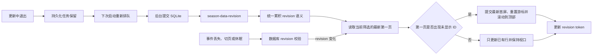

# 对局列表动态刷新完整实施方案

## 背景

后台自动更新能够把新对局正常写入 SQLite，但对局页的实时增量刷新存在事件覆盖和请求竞态：列表提交产生的 `list` revision 可能被后续 `detail` revision 覆盖，页面随后按“只更新已有行”的详情语义合并，导致部分新对局不进入当前列表。页面又记录了最新 revision token，因此继续等待也不一定再次刷新；重启后通过完整数据库加载才会恢复正常。

本方案同时覆盖停留等待、切换页面、滚动离开顶部、切换账号、程序退出重启、窗口休眠恢复和事件丢失等使用场景。

## 目标

- 消除 `list → detail` 事件覆盖导致的新对局丢失。
- 消除详情查询抢占列表查询导致的请求竞态。
- 切页返回、窗口恢复和事件丢失后能够自动协调数据库状态。
- 程序在更新任意阶段退出后，下次启动能够安全恢复。
- 发现当前筛选下的新对局时自动进入“最新首屏”状态：滚动到顶部，只保留第一页并重置分页游标。
- 纯详情更新继续保留滚动位置、分页尾部、当前选中项、筛选条件和未保存的收藏备注。
- 不新增依赖，不修改数据库结构，不重写后台同步任务。

## 总体数据流



## 一、统一事件语义

修改 `apps/owstats-desktop/src/features/matches/liveMatchTimeline.ts`。

新增纯函数：

```ts
coalesceLiveTimelineRevision(current, incoming)
```

输出统一的失效通知：

```ts
type LiveTimelineInvalidation = SeasonDataRevisionEvent & {
  requiresListMerge: boolean;
};
```

合并规则：

- 任意尚未成功提交的事件包含 `list + newMatches > 0` 时，`requiresListMerge` 保持为 `true`。
- 后续 `detail` 或 `completed` 事件不能将它降级。
- revision、状态和待补详情数量使用最新事件的数据。
- `newMatches` 在同一批未派发事件中累加，避免多模式防抖后只显示最后一批数量。
- 账号和赛季分别累积，禁止跨账号或跨赛季合并。
- 包含列表变化的事件使用 150ms 防抖；纯详情事件维持 400ms。

控制器和页面共同复用该函数，避免维护两套事件优先级逻辑。

同步调整：

```ts
chooseLiveTimelineRefresh()
reconcileLiveTimelinePage()
```

它们改为根据 `requiresListMerge` 决策，不再直接依赖最后一个事件的 `phase`。

## 二、修复页面请求竞态

修改 `apps/owstats-desktop/src/pages/MatchesPage.tsx`。

事件接收流程改为：

1. 先把新事件按账号和赛季累积到 `pendingRevisionEventsRef`。
2. 再根据累积结果立即读取当前筛选的最新第一页。
3. 即使详情请求抢占列表请求，最新请求拿到的仍然是 `requiresListMerge=true`。
4. 只有成功提交最新数据库页面后才清空 pending revision。
5. 查询失败、页面卸载或请求被判定为过期时不能清空 pending revision。

目标时序：

```text
list revision 1
→ 发起查询 A
→ detail revision 2
→ 发起查询 B
→ A 被判过期
→ B 继承列表语义
→ 比较最新首屏与当前列表的 match ID
→ 发现新 ID 后原子提交最新首屏并滚动到顶部
```

静默刷新失败时保留当前列表，不展示阻塞式整页错误；pending revision 留待下一次事件、后台校验或手动重试处理。

## 三、最新首屏、滚动、选择和分页行为

### 当前筛选下出现新对局

- 无论用户当前是否位于顶部，都立即读取并提交最新第一页，不再显示“发现 N 场新对局”提示。
- 列表替换为数据库返回的最新首屏（当前页大小为 50），不保留此前加载的第二页及以后内容。
- `nextCursor` 替换为最新首屏返回的游标，后续“加载更多”从这个新游标继续。
- 列表容器滚动位置重置为 `0`，缓存中的 `scrollTop` 也写为 `0`，滚动锚点清空。
- 正在进行的旧分页请求由 request id 判为过期；加载中和加载错误状态同时清理。
- 已选中的旧对局如果只是落在新首屏之后，详情选择和未保存的收藏备注继续保留；列表数据本身仍只保留最新首屏。

### 没有新的可见对局

- 如果后台事件只改变已有对局详情，按 ID 更新已有行，不插入当前列表中未出现的行。
- 当前滚动位置、已加载分页尾部、`nextCursor`、选中项和未保存草稿全部保留。
- 后台报告有新对局，但它不符合当前筛选条件时，同样按纯详情语义处理，不误跳顶部。

页面通过统一的 `reconcileLiveTimelinePage()` 产生列表、游标和 `resetViewport`，避免列表、分页与滚动分别提交造成短暂不一致。

## 四、切页恢复

全局监听继续放在 `apps/owstats-desktop/src/App.tsx`，不随对局页卸载而停止。

调整页面行为：

- 离开对局页时取消页面订阅，并通过 request id 让在途查询失效。
- 回到对局页时始终执行一次数据库 revision 校验。
- 数据库已经变化时，比较当前筛选下的最新首屏；存在新 ID 时进入最新首屏状态，否则只更新已有行。
- 后台仍在更新时，后续全局事件继续增量刷新。
- 带筛选条件返回时，继续使用当前筛选条件查询。

删除容易产生竞态的内存事件握手：

- 删除 `getLiveMatchTimelineHandshake()`。
- 删除控制器的 `latestEvents` 和 `getLatestEvents()`。
- 页面重新挂载时以数据库 revision 为权威，不使用“最后一个内存事件”推断完整更新历史。

这样可以避免切回页面时最新事件恰好是 `detail`，再次遗漏新行。

## 五、事件丢失、最小化和休眠恢复

新增轻量数据库 revision 查询命令，涉及：

- `apps/owstats-desktop/src-tauri/src/commands.rs`
- `apps/owstats-desktop/src-tauri/src/lib.rs`
- `apps/owstats-desktop/src/shared/api.ts`
- `apps/owstats-desktop/src/shared/types.ts`

接口返回：

```ts
type MatchTimelineRevision = {
  accountScope: string;
  revisionToken: string;
};
```

后台直接复用现有 `live_season_update::revision_token()`，不新增数据库表或迁移。

对局页在以下时机检查 revision：

- 页面首次挂载。
- 窗口重新获得焦点。
- 页面从隐藏恢复为可见。
- 对局页可见期间每 15 秒执行一次兜底检查。

只有 token 变化时才读取完整第一页。正常情况下只执行一次很小的本地 SQLite revision 查询，不访问网络。

发现变化后：

- 比较数据库第一页与当前列表的 match ID。
- 存在未显示的新 ID 时，自动提交最新首屏并滚动到顶部。
- 只有已有行变化时，使用详情语义更新，不影响滚动。
- 账号 scope 不一致时拒绝结果，等待账号上下文重新加载。

正常事件刷新保持低延迟；事件完全丢失时最迟约 15 秒自愈。

## 六、退出和重启

后端退出恢复机制已经具备，不修改数据库同步实现：

- SQLite 事务避免留下半条对局。
- 已排队或正在运行的任务持久化。
- 启动时把遗留的 `running` 任务重新变成 `queued`。
- 分页从第一个未提交页继续。
- 详情只重试缺失项。
- 快照阶段不重新请求网络，也不产生重复行。

产品行为定义：

- 退出后更新不会继续在后台运行。
- 下次启动自动恢复未完成任务。
- 已经提交的数据启动后立即可见。
- 不拦截窗口关闭，不强迫用户等待后台完成。

## 七、账号、筛选和特殊列表

必须验证：

- 更新中切换账号时，旧账号事件不得更新新账号页面。
- 切回旧账号时，从该账号数据库恢复最新结果。
- 全部赛季和单赛季筛选分别使用对应 revision token。
- 模式、英雄、地图、结果、日期和收藏筛选继续生效。
- 新对局不符合当前筛选条件时不显示，也不误报数量。
- 已加载 100 场以上时，纯详情刷新不能截断分页尾部；发现新对局时应明确重置为最新首屏。
- 移动端详情面板打开时，刷新不能强制关闭面板或改变选中项。

## 八、实施顺序

### 1. 先增加失败测试

扩展 `apps/owstats-desktop/scripts/liveMatchTimeline.test.ts`：

- `list → detail` 在同一防抖窗口，最终仍要求列表合并。
- list 查询未完成时被 detail 查询抢占，新行仍全部出现。
- 多个列表事件正确累计新对局数量。
- `list → completed` 不能降级为 status-only。
- 纯 detail 仍只更新已有行。
- 不在顶部时，发现新对局仍自动进入最新首屏并重置视口。
- 账号和赛季事件保持隔离。
- stop/start 和 React StrictMode 生命周期不丢订阅。

运行测试并确认新增用例在修改实现前失败。

### 2. 实现共享事件合并规则

- 增加 `LiveTimelineInvalidation`。
- 实现 `coalesceLiveTimelineRevision()`。
- 控制器的 pending map 使用共享规则累积。
- 页面 pending ref 使用相同规则累积。
- 删除旧的“最后事件直接覆盖”逻辑。

### 3. 修复页面提交和滚动策略

- 让最新请求继承累积后的列表语义。
- 失败或过期请求不清理 pending 状态。
- 使用统一提交一次性替换最新首屏、最新游标，并重置滚动位置与锚点。
- 纯详情刷新保留分页尾部；最新首屏刷新保留旧详情选择和未保存草稿，但不保留旧分页数据。

### 4. 替换切页握手

- 删除内存 latest-event 握手。
- 页面挂载时读取数据库 revision。
- revision 不同时执行安全协调。

### 5. 增加 revision 兜底检查

- 增加后端 revision 查询命令。
- 接入页面挂载、focus、visibilitychange 和 15 秒可见页检查。
- 页面卸载时移除监听并清理定时器。

### 6. 完成全量验证

- 运行前端定向测试。
- 运行后台中断恢复测试。
- 运行完整构建和测试。
- 执行桌面程序手工验收矩阵。

## 九、自动化测试

### 事件和页面缓存

```powershell
cd apps/owstats-desktop
npx tsx scripts/liveMatchTimeline.test.ts
npx tsx scripts/matchesPageCache.test.ts
```

`matchesPageCache.test.ts` 需要补充：

- 更新查询中切页，旧响应不能提交。
- 返回页面时 token 不同会重新协调数据库。
- 返回页面时 token 相同不重复加载。
- 事件丢失后 revision 校验可以恢复。
- scrolled 状态发现新 ID 后自动应用最新首屏、重置游标并滚动到顶部。
- 纯详情或筛选后没有新 ID 时保持当前位置和分页尾部。
- 静默刷新失败保留列表和 pending revision。

### 账号隔离

```powershell
cd apps/owstats-desktop
npx tsx scripts/accountScopedFrontendCaches.test.ts
npx tsx scripts/accountOperationIsolation.test.ts
```

验证切账号时缓存、pending revision 和在途请求全部隔离。

### 退出恢复

```powershell
cd apps/owstats-desktop/src-tauri
cargo test --test background_season_sync recovery_
```

必须继续覆盖：

- 分页中断恢复。
- 详情中断恢复。
- 快照中断恢复且不重复写入。

### 全量验证

```powershell
cd apps/owstats-desktop
npm run check

cd src-tauri
cargo test
```

## 十、手工验收矩阵

1. 停留在对局页顶部完成自动更新，所有新对局自动出现。
2. 滚动到列表中部执行更新，发现符合筛选的新对局后自动滚动到顶部，并只保留最新首屏。
3. 更新中切到战报页，完成后返回对局页。
4. 更新中切页并立即返回，等待更新继续完成。
5. 分别在列表、详情和快照阶段退出程序并重启。
6. 最小化或休眠后等待更新，恢复窗口后自动协调。
7. 更新中切换账号，再分别检查两个账号。
8. 带赛季、模式、日期和收藏筛选等待更新。
9. 已加载多页并选中旧对局时等待更新，确认列表重置为最新首屏、旧详情选择和未保存草稿仍保留。
10. 模拟丢弃一次 Tauri revision 事件，确认 15 秒内自愈。

## 十一、完成标准

- 正常事件到列表可见时间小于 1 秒。
- 事件丢失后的兜底恢复不超过 15 秒。
- 当前筛选下发现新对局时，无论原位置在哪里，都自动进入最新首屏并滚动到顶部。
- 纯详情更新或新对局不符合筛选时，不发生自动位移或分页截断。
- 切页、切账号、退出重启后不存在跨账号数据和重复行。
- 新增回归测试能够在旧实现上失败、在新实现上通过。
- `npm run check` 和 `cargo test` 全部通过。
- 不新增第三方依赖。
- 不修改数据库结构。
- 不重写已有后台同步和任务恢复实现。
- 实施时保留工作区已有的反馈入口、图标和其他未提交修改，只进行定点补丁。

## 十二、明确不做的事项

- 不增加新的全局状态库。
- 不让程序退出时等待后台更新完成。
- 不把本地 revision 检查变成上游网络轮询。
- 不改变现有筛选、分页和收藏的数据结构。
- 不以重启、强制整页刷新或清空缓存作为正式修复方案。

## 十三、实施结果（2026-08-02）

本方案已实施完成：

- `list → detail/completed` 使用统一 invalidation 累积，列表语义在成功提交前保持 sticky。
- 页面按账号和赛季隔离 pending revision；过期、失败和卸载请求不会确认 pending。
- 当前筛选的最新首屏出现未显示 ID 时，自动原子提交最新 50 场、最新分页游标和顶部视口，不再等待用户点击提示。
- 纯详情更新及“后台有新对局但当前筛选不可见”的情况继续保留滚动位置和已加载分页尾部。
- 最新首屏提交保留仍在后续分页中的旧详情选择与未保存收藏草稿；旧列表分页数据不再保留。
- 页面首次挂载、窗口聚焦、从隐藏恢复和可见期间每 15 秒检查本地数据库 revision。
- 切页返回以数据库 revision 为权威，不再依赖内存 latest-event 握手。
- 程序退出恢复沿用已有持久化任务与启动重排机制，未新增迁移、数据表或依赖。

验证结果：

```powershell
cd apps/owstats-desktop
npm run check

cd src-tauri
cargo test
```

两项全量命令均通过。额外定向验证覆盖事件竞态、页面缓存、账号隔离，以及分页、详情、快照三个退出恢复阶段。
