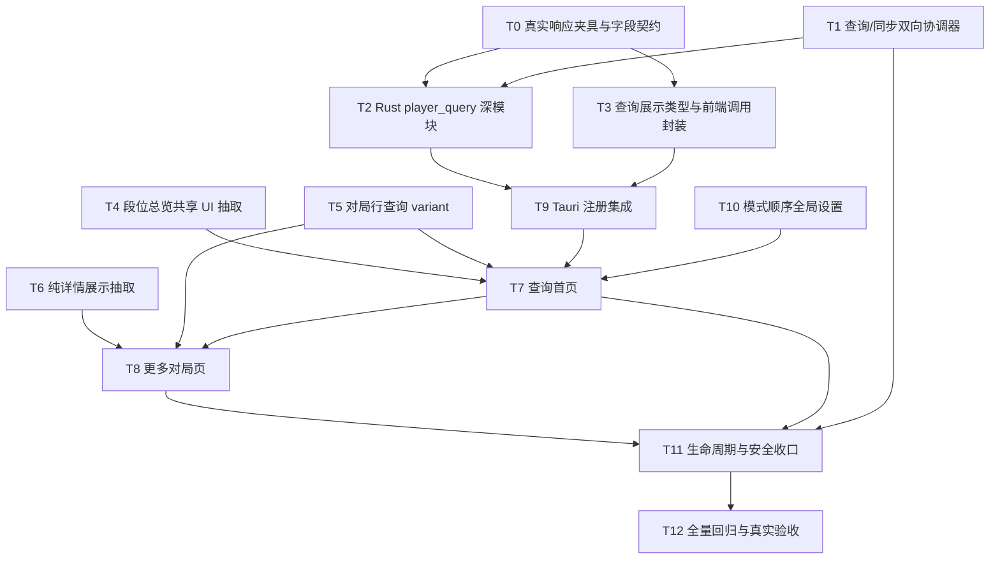

# 玩家即时查询：子代理驱动实施计划

## 1. 计划目标

依据 [玩家即时查询功能设计](docs/player-query-feature-design.md) 实现独立的玩家即时查询功能，并满足以下不可妥协条件：

- 使用当前本地账号的 `roleId + Bigdata token` 查询任意 BattleTag；
- 查询数据只存在内存，不写 SQLite、赛季 JSON、同步状态、日志、诊断或浏览器磁盘缓存；
- 默认只请求当前可见所需数据；不全量抓取、不预取分页、不预取详情；
- 查询与当前账号的任何前台/后台同步双向互斥；
- 复用现有段位、对局列表和详情 UI，避免复制近似实现；
- 查询首页与“更多对局”页遵循已确认的数据释放规则；
- 所有新增行为经过 Rust、TypeScript、视觉合同和敏感信息测试。

本计划用于主代理驱动多个实施子代理完成开发。子代理负责具体实现，主代理负责任务切分、共享文件集成、验收和最终回归。

## 2. 子代理驱动规则

### 2.1 主代理职责

主代理始终拥有：

- 任务依赖图和当前唯一真相；
- 共享注册文件的最终编辑权；
- 子代理任务说明、文件所有权和验收标准；
- 每个任务完成后的 diff 审查；
- 跨任务集成、冲突处理和全量验证；
- 设计文档与实现出现偏差时的裁决。

主代理不把“实现整个功能”一次性派给单个子代理，也不让多个子代理同时修改同一文件。

### 2.2 子代理任务粒度

每个实施子代理只接收一个可以独立验收的任务，理想范围：

- 1 个深模块或 1 次共享 UI 抽取；
- 2–6 个主要源码文件；
- 与任务直接对应的测试；
- 一组明确可运行的验证命令。

子代理必须在交付时报告：

1. 修改的文件；
2. 实现的 interface 和不变量；
3. 执行的测试及结果；
4. 未解决风险；
5. 是否触碰任务范围之外的文件。

### 2.3 文件所有权

同一时间只允许一个活跃任务拥有某个文件。以下共享注册文件默认由主代理或专门的“集成子代理”独占：

```text
apps/owstats-desktop/src/App.tsx
apps/owstats-desktop/src/shared/api.ts
apps/owstats-desktop/src/shared/types.ts
apps/owstats-desktop/src/shared/phase6Shell.ts
apps/owstats-desktop/src-tauri/src/lib.rs
apps/owstats-desktop/src-tauri/src/commands.rs
apps/owstats-desktop/src-tauri/src/models.rs
apps/owstats-desktop/package.json
```

并行任务不得编辑这些文件；它们只提交模块文件和建议的注册清单，由集成任务统一接线。

### 2.4 并行原则

最多同时运行三个实施子代理，保留主代理用于检查与集成。只有满足以下条件的任务可以并行：

- 文件集合不重叠；
- interface 已由前置任务冻结；
- 不依赖另一并行任务的未提交实现；
- 测试使用独立夹具或独立临时目录。

### 2.5 每项任务的执行循环

```text
主代理冻结任务 interface
→ 派发实施子代理
→ 子代理实现并运行定向测试
→ 主代理检查 diff 与测试证据
→ 必要时原子返工同一子代理
→ 主代理运行相邻回归测试
→ 标记任务完成并解锁下游任务
```

“代码存在”不等于完成。只有接口、行为、测试和敏感数据约束都通过，任务才可进入 completed。

## 3. 总体依赖图



## 4. 实施波次

## Wave 0：冻结事实与 interface

### T0：建立上游响应夹具与字段契约

**执行者**：后端调查子代理

**目标**：在写页面之前确认 S15、S20、S21、S22、S23 的资料卡、段位、六种模式统计、列表和普通/角斗详情的真实字段形状。

**允许修改**：

```text
apps/owstats-desktop/src-tauri/tests/fixtures/player_query/**
apps/owstats-desktop/src-tauri/tests/player_query_contracts.rs
```

**禁止修改**：生产源码、真实凭据文件、现有抓取产物。

**工作内容**：

- 使用有授权的测试账号进行一次性只读采样；
- 对真实响应立即脱敏：移除 Bigdata token、`customerToken`、Cookie、traceId 和不必要的玩家标识；
- 为以下响应各保存最小结构夹具：
  - `searchBnetAccount`；
  - `queryCard`；
  - 六种模式的 `queryCountInfo`；
  - 六种模式第 1 页和末页；
  - 普通详情；
  - 角斗详情；
- 明确 `gameTime` 单位、赞赏等级、title/titleIcon、段位字段、英雄时长/胜率、列表页大小和详情结构；
- 证明角斗列表不需要地图字段，列表预览固定使用本地 `stadium.png`；
- 编写夹具敏感字段扫描测试。

**完成条件**：

- 五个赛季、六种模式的差异已用测试表达；
- 生产类型没有基于猜测添加字段；
- 夹具不含任何真实 secret；
- `cargo test --test player_query_contracts` 通过。

### T1：升级查询/同步双向协调器

**执行者**：并发状态子代理

**目标**：先消除竞态，再允许创建查询 session。

**现状风险**：现有 `SyncCoordinator` 只有一个全局 busy bool。后台 `wake` 与 worker 获取 permit 分离，可能出现后台任务已 queued、查询却抢先进入的窗口。

**允许修改**：

```text
apps/owstats-desktop/src-tauri/src/sync_coordinator.rs
apps/owstats-desktop/src-tauri/src/background_sync.rs
apps/owstats-desktop/src-tauri/tests/account_operation_isolation.rs（若存在或新增对应测试）
apps/owstats-desktop/src-tauri/tests/player_query_coordination.rs
```

**interface 要求**：

- 明确区分：账号操作、前台同步、后台 queued/running、查询 session；
- 后台任务登记与查询许可获取必须原子互斥；
- 查询许可持有整个查询会话，而不是只持有一次 command；
- 查询存在时 `sync_season`、retry 和 background wake 都必须拒绝；
- 同步存在时查询 start 必须拒绝；
- 双方都不排队、不自动开始；
- permit drop 后状态必定释放，panic/错误路径不能永久锁死。

**测试场景**：

- foreground sync → query 被拒绝；
- background queued → query 被拒绝；
- background running → query 被拒绝；
- query session → foreground sync/retry/wake 被拒绝；
- query release → sync 可进入；
- sync release → query可进入；
- 两线程竞争只有一个成功；
- 不同错误路径不会泄漏 permit。

**完成条件**：

- 协调器测试可重复运行，无时序偶现；
- 现有同步测试保持通过；
- 尚未接入 UI，但 Rust seam 已冻结。

## Wave 1：并行建立后端深模块与共享 UI seam

T2、T4、T5、T6 可以并行，文件不得重叠。

### T2：实现 Rust `player_query` 深模块

**执行者**：后端实现子代理

**前置**：T0、T1

**允许修改**：

```text
apps/owstats-desktop/src-tauri/src/player_query/mod.rs
apps/owstats-desktop/src-tauri/src/player_query/models.rs
apps/owstats-desktop/src-tauri/src/player_query/mapper.rs
apps/owstats-desktop/src-tauri/src/player_query/session.rs
apps/owstats-desktop/src-tauri/src/player_query/upstream.rs
apps/owstats-desktop/src-tauri/tests/player_query.rs
```

**只读复用**：

```text
dashen_client.rs
credentials.rs
credential_store.rs
account_context.rs
sync_coordinator.rs
assets/runtime lookups
queries/normal_detail.rs
queries/arena_detail.rs
```

**外部 interface**：

```rust
start_query(battle_tag) -> SessionStart
load_card(session_id) -> PlayerQueryCard
load_season(session_id, season) -> SeasonOverview
load_mode_page(session_id, season, mode, page) -> ModePage
load_match_detail(session_id, match_kind, match_id) -> MatchDetailView
release_more_data(session_id) -> ()
end_query(session_id) -> ()
```

具体 Tauri command 名称由 T9 注册，但行为在这里冻结。

**implementation 要求**：

- `start_query`：规范化全角 `＃`、校验 BattleTag、读取当前账号凭据、获取 query permit、搜索目标并核验返回身份；
- session 只在 Rust 内存保存当前账号 ID、规范化 BattleTag、`customerToken`、当前 permit 和 generation；
- 前端永远拿不到 Bigdata token 或 `customerToken`；
- session 不读取 `player_target.json`、SQLite 或赛季 JSON；
- 相同 BattleTag 刷新保留当前筛选由前端决定；不同目标建立新 generation；
- 六种精确模式分别路由普通或 fight 接口；
- S23 使用现有兼容参数策略，其他赛季显式传 season；
- 资料卡、段位、列表、英雄统计彼此独立返回；
- `page=1` 时列表和英雄统计在同一 `DashenClient` 实例内并行，复用同一请求 gate；
- `page>1` 只请求列表，不重复请求英雄统计；
- 原始页少于 12 条即 `endReached`；去重后不改变上游顺序；
- 详情状态由前端只保留当前项，后端不建立跨项详情缓存；
- 401/403 返回明确的 session-invalid 类别并结束 session；
- 网络/429/结构异常映射为脱敏局部错误；
- 不打印 raw response 或 secret。

**内部 seam**：

定义 `PlayerQueryUpstream` port。生产 adapter 复用 `DashenClient`；测试 adapter 使用内存夹具。这是网易真外部依赖的真实 seam。

**测试重点**：

- 请求计数精确：未滚动无 page 2，未选中无详情；
- 六模式路由正确；
- 模式/赛季/目标 generation 迟到响应被拒绝；
- S15/S20–S23 mapper；
- 角斗行无地图名；
- 普通地图、英雄、K/A/D、MM-DD 映射；
- 缺失比分为 `-`，字段独立降级；
- 查询自身仍不读本地库；
- query session 持有并释放协调器许可；
- 任何结果与错误都不含 secret。

### T3：冻结前后端查询展示类型与调用封装

**执行者**：类型契约子代理

**前置**：T0；可与 T2 后半段协作，但 interface 由主代理先冻结

**允许修改**：

```text
apps/owstats-desktop/src/features/player-query/playerQueryTypes.ts
apps/owstats-desktop/src/features/player-query/playerQueryApi.ts
apps/owstats-desktop/scripts/playerQueryContracts.test.ts
```

**要求**：

- 类型只表达 UI 需要的稳定字段；
- 不出现 token、`customerToken`、raw JSON；
- 固定赛季联合类型：`15 | 20 | 21 | 22 | 23`；
- 固定六模式联合类型和中文标签映射；
- `PlayerQueryMatchRow` 支持普通地图名、角斗无地图名；
- 资料卡身份字段为 `battleTag`，不含 `name`；
- loading/error 保持前端状态，不混入数据 DTO；
- 调用封装只调用 Tauri commands，不编排业务缓存。

### T4：抽取共享段位总览 UI

**执行者**：共享 UI 子代理 A

**允许修改**：

```text
apps/owstats-desktop/src/features/review/RoleRankOverview.tsx
apps/owstats-desktop/src/pages/PersonalReviewPage.tsx
apps/owstats-desktop/scripts/roleRankOverview.test.tsx
apps/owstats-desktop/src/styles/features/review.css（只做必要抽取）
```

**要求**：

- 从 `PersonalReviewPage` 提取 `RoleAndHeroView` 中的职责段位展示；
- 战报页视觉和行为零回归；
- 查询页可传 competitive/stadium 数据和 loading/error/empty；
- 缺失胜率/场次/KDA显示 `-`，不隐藏卡位；
- 模块不负责请求或本地数据库逻辑。

### T5：为现有对局行增加查询 variant

**执行者**：共享 UI 子代理 B

**允许修改**：

```text
apps/owstats-desktop/src/features/matches/MatchListCard.tsx
apps/owstats-desktop/src/shared/matchListFormat.ts
apps/owstats-desktop/src/styles/features/matches.css
apps/owstats-desktop/scripts/playerQueryMatchRow.test.tsx
```

**要求**：

- 新增 `variant="playerQuery"` 或等价明确 interface；
- 本地 `/matches` 默认 variant 零回归；
- 查询 variant 一行展示胜负、比分、普通地图名、英雄头像/名称、K/A/D、MM-DD；
- 角斗不显示地图名，MapPreview 固定 `assets/maps/stadium.png`；
- 隐藏收藏、伤害/治疗/抵挡和评价徽章；
- 普通未知地图使用通用占位，不误用 stadium 图；
- 不为了复用而构造虚假的完整 `MatchSummary`。

### T6：抽取纯对局详情展示

**执行者**：共享 UI 子代理 C

**允许修改**：

```text
apps/owstats-desktop/src/features/matches/CompactMatchDetail.tsx
apps/owstats-desktop/src/features/matches/MatchDetailContent.tsx
apps/owstats-desktop/src/features/matches/MatchDetailPane.tsx
apps/owstats-desktop/scripts/playerQueryMatchDetail.test.tsx
```

**要求**：

- 抽出不依赖持久化的普通与角斗纯展示；
- 本地对局页继续显示收藏、AI 锐评、标签/评价能力；
- 查询 capability 全部关闭：收藏、标签、AI、重新评价、本地徽章；
- 查询页仍显示队伍、比分、时间、地图、回合、英雄、装备/异能；
- 切换详情时支持纯 loading，不继续展示上一场；
- 本地现有详情测试保持通过。

## Wave 2：设置与后端注册

### T10：全局模式顺序设置

**执行者**：设置子代理

**允许修改**：

```text
apps/owstats-desktop/src-tauri/src/settings.rs
apps/owstats-desktop/src-tauri/tests/player_query_settings.rs
apps/owstats-desktop/src/features/player-query/modeOrder.ts
apps/owstats-desktop/scripts/playerQueryModeOrder.test.ts
```

共享 `UserSettings` 类型和注册由 T9 统一修改。

**要求**：

- 全局而非账号级；
- 默认顺序严格为需求给出的六项；
- 读写时过滤未知值、去重、补缺项；
- 鼠标释放且顺序变化时立即保存；
- 保存失败保留本次内存顺序并返回可展示错误；
- 不保存当前 BattleTag、赛季、模式或任何查询数据；
- 无查询 session 时也可拖拽排序。

### T9：Tauri 与共享类型注册集成

**执行者**：集成子代理或主代理

**前置**：T1、T2、T3、T10 interface 冻结

**独占修改**：

```text
apps/owstats-desktop/src-tauri/src/lib.rs
apps/owstats-desktop/src-tauri/src/commands.rs
apps/owstats-desktop/src-tauri/src/models.rs
apps/owstats-desktop/src/shared/api.ts
apps/owstats-desktop/src/shared/types.ts
apps/owstats-desktop/package.json
```

**要求**：

- 注册 player_query 状态和 commands；
- command 只做 Tauri 参数转换，业务在深模块内；
- 将全局模式顺序加入 `UserSettings`，保持旧 settings 文件兼容；
- 把新增前端定向测试加入正确的 npm test 分层；
- 不在共享类型中暴露 secret；
- `cargo check`、`npm run build` 通过。

## Wave 3：查询首页

### T7：实现查询首页与前端状态深模块

**执行者**：查询首页子代理

**前置**：T3、T4、T5、T9、T10

**允许修改**：

```text
apps/owstats-desktop/src/pages/PlayerQueryPage.tsx
apps/owstats-desktop/src/features/player-query/PlayerQueryForm.tsx
apps/owstats-desktop/src/features/player-query/PlayerProfileCard.tsx
apps/owstats-desktop/src/features/player-query/PlayerQueryModeTabs.tsx
apps/owstats-desktop/src/features/player-query/PlayerQueryMatchList.tsx
apps/owstats-desktop/src/features/player-query/PlayerHeroUsage.tsx
apps/owstats-desktop/src/features/player-query/usePlayerQuerySession.ts
apps/owstats-desktop/src/features/player-query/playerQueryState.ts
apps/owstats-desktop/src/styles/features/player-query.css
apps/owstats-desktop/scripts/playerQueryPage.test.tsx
apps/owstats-desktop/scripts/playerQueryState.test.ts
```

**主状态 interface**：

```ts
startQuery(battleTag)
changeSeason(season)
selectMode(mode)
reorderModes(order)
retry(scope)
openMatch(matchId)
openMore()
leaveQuery()
```

**行为要求**：

- 未登录或同步活动时显示完整骨架但禁用查询；模式拖拽仍可用；
- BattleTag 支持半角/全角井号；
- search 建 session 期间禁用提交，无取消按钮；
- session 建立后并行加载资料卡、S23 段位、默认模式第一页和英雄统计；
- 四区域独立 loading/error/retry；
- 同一 BattleTag 刷新保留当前赛季/模式；不同目标重置 S23/第一模式；
- 赛季/模式切换立即丢弃旧数据，允许在 loading 中继续切换；
- 模式拖拽不触发查询、不改变当前选择；
- 首页列表最多 12 场，无内部滚动；
- 常用英雄过滤零时长，展示数量由真实 UI 高度确定；
- 宽屏 1:1，窄屏上下布局；
- 列表为空不阻止英雄统计展示；
- 首页绝不请求详情或第 2 页；
- 不写 URL 参数、localStorage、sessionStorage 或数据库。

**图片要求**：

- 资料卡文字先显示；
- Rust 内存图片独立局部加载；
- WebView 不直接访问远程图片 URL；
- 图片失败只保留占位。

## Wave 4：更多对局页

### T8：实现查询对局工作台

**执行者**：查询详情页子代理

**前置**：T5、T6、T7、T9

**允许修改**：

```text
apps/owstats-desktop/src/pages/PlayerQueryMatchesPage.tsx
apps/owstats-desktop/src/features/player-query/PlayerQueryMatchesWorkbench.tsx
apps/owstats-desktop/src/features/player-query/usePlayerQueryPagination.ts
apps/owstats-desktop/src/styles/features/player-query-matches.css
apps/owstats-desktop/scripts/playerQueryMatchesPage.test.tsx
apps/owstats-desktop/scripts/playerQueryPagination.test.ts
```

**要求**：

- 独立路由，复用现有对局工作台左右布局；
- 无筛选器、收藏、标签、AI 或模式/赛季切换；
- 显式“返回查询”按钮；
- 标题为 `BattleTag · Sxx · 中文模式`；
- 点击首页行选择该行；点击“更多对局”选择第一页第一行；
- 进入时只请求入口指定详情；
- 切换行立即丢弃旧详情，显示 loading，再请求新详情；
- 左侧独立滚动，已有第一页不重复请求；
- 必须发生新的向下滚动意图且 sentinel 到阈值才请求下一页；
- 一次一页，原始条数少于 12 即结束；
- 分页错误只在底部局部重试；
- 返回首页释放第 2 页以后、详情和滚动位置；
- 浏览器前进重新进入时等同“更多对局”，默认第一页第一场；
- 列表普通/角斗规则与首页完全相同。

## Wave 5：路由、导航与生命周期集成

### T11：应用级接线与安全收口

**执行者**：集成子代理或主代理

**前置**：T7、T8

**独占修改**：

```text
apps/owstats-desktop/src/App.tsx
apps/owstats-desktop/src/shared/phase6Shell.ts
apps/owstats-desktop/src/shared/qaFeedback.ts
apps/owstats-desktop/src/styles.css（仅 import）
apps/owstats-desktop/scripts/phase6Shell.test.ts
apps/owstats-desktop/scripts/playerQueryNavigation.test.tsx
apps/owstats-desktop/src-tauri/src/commands.rs（仅必要生命周期 command）
```

**要求**：

- 顶部“查询”位于“对局”和“战报”之间；
- 注册 `/player-query` 和 `/player-query/matches`；
- URL 不含 BattleTag、赛季、模式或 session；
- 两个查询路由间保留必要会话；
- 离开整个查询功能立即调用 `end_query` 并释放 sync/query permit；
- 切换账号、401/403、刷新和应用退出都释放 session；
- 直接进入更多路由且无 session 时跳回查询首页；
- 查询 session 活动时指挥台同步按钮显示互斥提示；
- 同步活动时查询页显示互斥提示；
- 所有错误使用脱敏产品文案。

## Wave 6：专项安全与回归

### T12：完整验证和真实验收

**执行者**：验证子代理；主代理最终复核

**前置**：全部实现任务完成

**自动测试**：

```powershell
cd D:\Codex\OW_data\owstats-local\apps\owstats-desktop
npm test
npm run build

cd D:\Codex\OW_data\owstats-local\apps\owstats-desktop\src-tauri
cargo fmt --check
cargo clippy --all-targets -- -D warnings
cargo test --tests

cd D:\Codex\OW_data\owstats-local
powershell -ExecutionPolicy Bypass -File scripts\verify.ps1 -ChangedOnly
git diff --check
```

**专项不落盘测试**：

1. 在临时 app root 建立合成账号和数据库；
2. 记录查询前目录树、文件 hash、SQLite page/data version；
3. 执行搜索、资料卡、赛季、六模式第一页、分页和详情；
4. 结束 session；
5. 对比查询前后：除显式模式顺序设置测试外，不得出现文件新增或内容变化；
6. 扫描 stdout/stderr、Tauri 事件和错误对象，确保没有两类 token、Cookie、Authorization 或 raw response；
7. 验证 WebView 不收到远程图片 URL。

**真实网络手测**：

- 使用有权限的测试账号；
- 验证 S15/S20/S21/S22/S23；
- 验证六种精确模式；
- DevTools/代理统计首屏请求数；
- 首页未发生详情或 page 2 请求；
- 更多页未滚动不发生 page 2；
- 切详情只请求当前场；
- 切模式/赛季丢弃旧响应；
- 角斗列表统一 stadium 图且无地图名；
- 查询/同步互斥无竞态；
- 退出查询后数据目录无业务变化。

**视觉验收**：

- 资料卡文本先于图片可见；
- 段位总览与战报共用同一模块；
- 查询对局行与现有 UI 同源；
- 常用英雄数量依据真实行高确定并写入测试夹具；
- 宽屏左右 1:1；窄屏上下排列；
- 更多页列表独立滚动，详情右侧稳定；
- loading/error/empty 不造成明显布局跳变。

## 5. 子代理派发顺序

推荐执行队列：

```text
批次 A（并行）
  Agent 1 → T0 响应夹具
  Agent 2 → T1 协调器
  Agent 3 → T4 段位 UI 抽取

批次 B（T0/T1 完成后并行）
  Agent 1 → T2 Rust player_query
  Agent 2 → T5 对局行 variant
  Agent 3 → T6 纯详情抽取

批次 C（interface 冻结后并行）
  Agent 1 → T3 前端类型契约
  Agent 2 → T10 设置
  主代理 → 审查 T2/T5/T6 并准备 T9

批次 D（串行集成）
  集成 Agent → T9 Tauri/共享类型注册
  主代理 → 定向回归和 interface 冻结

批次 E
  Agent 1 → T7 查询首页
  主代理 → 审查首屏请求计数与数据生命周期

批次 F
  Agent 1 → T8 更多对局页
  Agent 2 → 补充 T7/T8 视觉夹具（不修改页面实现文件）

批次 G（串行集成）
  集成 Agent → T11 路由/导航/生命周期
  主代理 → 查询/同步竞态审查

批次 H
  验证 Agent → T12 自动与专项验证
  主代理 → 最终 diff、真实手测和交付
```

## 6. 主代理验收门

每个 Wave 结束后必须通过对应门，不能靠后续任务“顺便修”。

### Gate A：事实与并发

- 字段夹具已脱敏；
- 协调器无 queued/running 竞态；
- query permit 生命周期明确。

### Gate B：共享 seam

- 战报页、对局页视觉和行为无回归；
- 查询展示类型不含 secret/raw；
- Rust 深模块测试能精确断言请求次数。

### Gate C：首页最小请求

- search 后四块并发；
- 只加载排序第一模式第一页；
- 没有详情、page 2 或其他模式请求；
- 切换立即丢弃旧数据。

### Gate D：更多页按需行为

- 入口指定详情仅请求一次；
- 无滚动无 page 2；
- 无新滚动意图不连续加载；
- 返回清理范围准确。

### Gate E：安全与交付

- 查询数据零业务落盘；
- 两类 token 不进入前端、日志、错误或夹具；
- 查询与同步双向互斥；
- npm、Rust、verify、build 全绿。

## 7. 子代理任务模板

主代理每次派发使用以下模板，避免范围漂移：

```text
任务：T{编号} {名称}

目标：
{一个可验证结果}

前置事实/interface：
{已冻结的类型、行为和依赖}

你独占的文件：
{明确文件列表}

禁止修改：
{共享注册文件和其他代理文件}

必须实现：
{行为清单}

必须测试：
{测试场景与命令}

交付时报告：
修改文件、测试结果、风险、越界情况。

不要：
提交 Git、修改真实数据、读取/输出真实 token、扩大任务范围。
```

## 8. 完成定义

只有同时满足以下条件，整个功能才算完成：

- 设计文档的验收标准全部通过；
- 所有 Gate 通过且没有跳过项；
- 查询请求数能被测试精确证明是最小集合；
- 查询数据与远程图片不落盘；
- 查询/同步双向互斥不存在竞态；
- 现有战报、对局、同步、多账号功能无回归；
- 常用英雄最终数量和响应式断点已通过真实 UI 测量确定并回写设计文档；
- 主代理完成最终代码审查、测试复核和交付说明。

