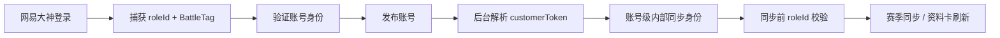

# OWStats Local 项目改进实施方案

更新日期：2026-08-02

实施分支：`codex/project-improvements`

实施目录：独立的 `owstats-local-implementation` worktree

## 1. 结论与修正

本方案纠正此前“恢复 BattleTag 重新绑定界面”的判断。

BattleTag 已在网易大神登录流程中抓取，并作为账号资料的一部分保存。产品不需要再暴露第二套“目标玩家”概念，也不应要求用户在登录后执行切换、保留、重试绑定或清除目标等操作。旧实现把同步接口所需的 `customerToken` 与用户可操作的 BattleTag 状态混为一体，形成了重复状态源和无法解释的恢复流程。

正确边界是：

1. 登录流程捕获并确认当前账号的 `roleId + BattleTag`。
2. 登录发布账号时，后端自动用 BattleTag 查询同步接口所需的私有 `customerToken`。
3. `customerToken` 只作为账号级内部同步身份持久化，不进入前端状态或 IPC 返回值。
4. 每次同步前验证内部同步身份属于当前账号；不一致时失败关闭，并提示重新添加账号。
5. 不提供单独的 BattleTag 重新绑定、切换、保留、重试或清除功能。

## 2. 根因分析

### 2.1 为什么开发分支出现主分支很久以前删除的内容

该分支基于包含旧“登录目标”实现的历史提交继续开发。后续提交曾删除界面 JSX，但没有同步删除：

- React 状态和事件处理器；
- `shared/api.ts` 的 IPC 适配器；
- Rust Tauri 命令及注册；
- `LoginTargetCoordinator` 状态机；
- `player_target.json` 的用户态查询与清除接口；
- 对应样式和测试。

因此，简单把遗留处理器判断为“界面误删造成的死代码”，会错误地把已删除功能重新带回开发版。真正问题是分支基线和后续重构没有完成语义迁移，而不是主分支内容自动恢复。

### 2.2 为什么相关状态、处理函数和 Rust 命令一直存在

旧设计同时承担了两件事：

- 用户身份：登录时识别的 BattleTag；
- 同步凭据：赛季和资料卡接口所需的 `customerToken`。

因为第二项仍被同步链路依赖，旧代码删除 UI 时保留了整个状态机和命令层。随着多账号功能加入，这套全局“目标玩家”状态又与账号级状态重叠，最终留下无真实产品价值的操作入口。

## 3. 目标架构



前端只关心账号是否存在、凭据是否有效、同步是否进行中。BattleTag 显示来自登录后保存的账号资料卡，不再拥有独立状态机。

## 4. 实施范围

### 4.1 前端删除项

- 删除 `LoginTargetStatus`、`PlayerTargetStatus` 和清除结果类型。
- 删除 `getLoginTargetStatus`、`recoverLoginTarget` 等 API。
- 删除 `TargetRecoveryPanel` 及其状态、焦点和事件处理逻辑。
- 删除 `targetStatus` 快照字段和 `targetSyncAllowed` 参数。
- 删除目标切换、保留、重试、清除相关 CSS。
- 更新账号管理、自动同步和视觉夹具测试。

### 4.2 Rust 删除项

- 删除 `login_target.rs` 与 `LoginTargetCoordinator`。
- 删除以下 Tauri 命令及注册：
  - `get_login_target_status`
  - `confirm_login_target_switch`
  - `keep_login_target`
  - `retry_login_target_binding`
  - `clear_player_target`
- 删除用户态目标状态模型与清除接口。
- 删除旧目标状态机的集成测试。

### 4.3 Rust 保留与收口项

保留账号同步所需的最小内部数据结构和磁盘兼容格式，集中到 `account_sync_identity` 模块：

- 登录发布前验证搜索结果、资料卡、BattleTag 和 `roleId` 一致；
- 登录发布后自动刷新 `customerToken`；
- 同步前验证持久化身份属于当前账号；
- 上游 401/403 或身份不一致判定为拒绝；
- 网络及临时服务故障判定为可重试失败；
- 不向前端暴露 `customerToken`。

继续沿用账号目录中的 `player_target.json` 文件名，仅为兼容现有本地数据；它不再代表用户可操作的“目标玩家”。后续若要改名，应单独设计一次带回滚能力的数据迁移，避免已有账号突然无法同步。

## 5. 实施步骤与状态

| 阶段 | 工作 | 状态 |
|---|---|---|
| 1 | 建立遗留功能边界测试，证明旧 UI/API/命令仍存在 | 已完成 |
| 2 | 新建内部账号同步身份模块 | 已完成 |
| 3 | 迁移普通登录、二维码登录、自动同步和手动同步调用点 | 已完成 |
| 4 | 删除前端状态、处理函数、IPC 适配器和样式 | 已完成 |
| 5 | 删除 Rust 状态机、命令、模型和注册 | 已完成 |
| 6 | 更新测试与实施文档 | 已完成 |
| 7 | 前后端全量回归、静态检查和构建验证 | 已完成 |

## 6. 关键验收标准

### 6.1 产品行为

- 登录后无需再次识别或绑定 BattleTag。
- 指挥台不显示目标玩家恢复区域。
- 切换账号后只使用该账号目录中的凭据、资料卡和同步身份。
- 内部同步身份缺失或与当前 `roleId` 不一致时，不发送同步请求。
- 错误提示引导用户重新添加账号，不出现“切换目标”“保留目标”等旧概念。

### 6.2 安全与数据隔离

- `customerToken` 不进入 React 状态、IPC 状态响应或日志。
- 新账号发布前必须通过搜索结果和资料卡身份验证。
- 持久化同步身份必须携带并匹配来源 `roleId`。
- 旧版没有来源 `roleId` 的文件按不可信处理，不跨账号复用。
- 账号切换和删除期间继续受账号操作互斥锁保护。

### 6.3 自动化门禁

在 `apps/owstats-desktop` 执行：

```powershell
npm run check
Set-Location src-tauri
cargo test --all-targets
cargo clippy --all-targets -- -D warnings
cargo fmt --check
```

仓库级验证：

```powershell
# 在独立 worktree 的仓库根目录执行
.\scripts\verify.ps1
.\scripts\verify.ps1 -ChangedOnly
```

发布包验证应使用仓库现有打包脚本，并检查生成物不依赖未跟踪文件。

## 7. 分支开发版单独调试

该分支使用独立 worktree，不会修改主分支工作目录：

```powershell
# 先进入独立 worktree 下的 apps\owstats-desktop
npm install
npm run tauri dev
```

如只调试前端：

```powershell
npm run dev
```

如只验证 Rust：

```powershell
Set-Location src-tauri
cargo test --all-targets
```

调试时先确认所在分支和目录：

```powershell
git branch --show-current
git status --short
```

预期分支是 `codex/project-improvements`，路径包含 `owstats-local-implementation`。主工作区和该 worktree 的应用数据默认可能仍指向同一系统用户目录；若需要同时运行两个开发版，应通过项目支持的环境配置隔离端口和应用数据目录，避免互相覆盖本地账号数据。

## 8. 人工回归清单

- 添加一个有效账号，确认资料卡直接显示登录时获取的 BattleTag。
- 不执行任何额外绑定操作，直接同步一个赛季。
- 添加第二个账号并切换，确认资料卡和同步数据随账号切换。
- 删除当前账号，确认不会继续使用已删除账号的同步身份。
- 模拟旧版无 `sourceRoleId` 的内部文件，确认同步失败且不发网络请求。
- 模拟 401/403、业务错误、资料卡身份不一致和网络超时，确认失败分类正确。
- 重启应用，确认当前账号仍可同步且无目标恢复界面。

## 9. 回滚策略

本次变更不删除用户磁盘中的 `player_target.json`，因此代码回滚不会丢失同步身份数据。若新登录解析出现回归，可回滚 `account_sync_identity` 调用点和对应提交；不要恢复用户可见的重新绑定状态机。需要临时恢复同步时，应优先修复自动解析逻辑或让用户重新添加账号。

## 10. 后续改进

- 将内部文件名从 `player_target.json` 迁移为语义明确的 `account_sync_identity.json`，并提供原子迁移与回滚。
- 为登录身份验证增加独立的本地 HTTP 合约测试，覆盖成功、身份不一致、业务失败和临时网络失败。
- 在账号诊断信息中只暴露“同步身份可用/不可用”布尔值，不暴露 BattleTag 绑定状态或私有令牌。
- 为并行运行多个开发版补充官方的应用数据目录隔离配置。
