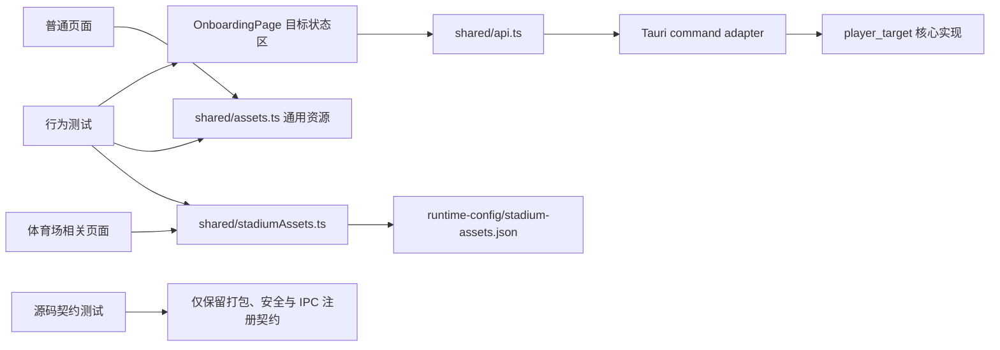

[agent-reach] Environment loaded
[agent-reach] Environment loaded
# OWStats Local 全项目改进实施方案

> 基线：`main@e660203`
> 编制日期：2026-08-02
> 适用目录：`apps/owstats-desktop`
> 文档性质：实施计划及完成记录
> 实施分支：`codex/project-improvements`
> 隔离工作树：仓库同级 `owstats-local-implementation`（以 `git worktree list` 为准）

## 1. 方案摘要

本轮改进按“先修正确性，再收紧质量门禁，最后做性能和维护性优化”的顺序实施。

审查中最重要的修正是：`OnboardingPage` 内的目标玩家切换、重试和清除逻辑不是应当直接删除的死代码。历史提交表明，`syncTargetStrip` 界面在清理 QA 区域时被一并移除，但其事件处理器、后端命令、样式和产品说明仍然保留。当前 `switchRequired`、`bindFailed` 等状态会禁止赛季同步，却没有向用户解释原因或提供恢复操作。因此第一阶段应恢复该界面并补上行为测试，之后才能安全启用 TypeScript 未使用代码检查。

其余工作聚焦于四个根因：

1. 通用资源模块在初始化时加载完整体育场资源清单，导致共享前端分块达到约 788 KB。
2. 前端测试大量验证源代码文本，而不是验证可观察行为，重构时噪声高、回归保护弱。
3. 前后端存在已失去调用方的公开接口和更新检查链路，扩大了维护面。
4. 验证脚本重复准备资源和重复执行 Rust 测试，反馈时间长且职责重叠。

本方案不引入新的框架、状态管理库或通用抽象层。每个改动只在已有真实边界上建立较小的接口：目标状态恢复界面、通用资源与体育场资源的 seam、前端 API 与 Tauri 命令的 seam、行为测试与实现细节的 seam。

## 2. 目标与成功指标

### 2.1 必须达成

- 目标玩家处于 `switchRequired`、`bindFailed`、已绑定和未绑定状态时，用户都能看到原因和可执行操作。
- `tsconfig.json` 开启 `noUnusedLocals` 与 `noUnusedParameters`，全项目编译通过。
- 删除没有生产调用方的前端导出、Tauri 命令适配器和应用更新检查链路；保留仍被内部业务或测试使用的核心函数。
- 任一生产 JavaScript 分块不超过 500 KB；原 `phase6Components` 分块目标低于 250 KB（均按 Vite 输出的 minified size 计）。
- 源码文本型前端测试从当前约 25 个降到不超过 10 个，`assert.match` 从约 620 次降到不超过 200 次；迁移后不能减少原有业务场景覆盖。
- 恢复目标界面后重新扫描 CSS，仅删除能够证明无调用方的规则。
- `verify.ps1` 不再显式重复执行已经由 npm 生命周期或 `cargo test --tests` 覆盖的步骤。
- 以下最终检查全部通过：前端检查、Rust 全目标测试、Clippy、格式检查、敏感路径扫描、干净工作区检查。

### 2.2 期望改善

- 冷启动和普通页面不再解析约 776 KB 的体育场源清单。
- 前端生产接口、Tauri 注册命令与真实调用方保持一一可追踪。
- 测试失败优先描述用户行为变化，而不是 JSX 排版或函数命名变化。
- 本地与 CI 的完整验证步骤减少重复工作，失败定位更直接。

## 3. 范围与非目标

### 3.1 本次范围

- `apps/owstats-desktop/src`：目标玩家 UI、资源模块、无用导出、相关样式。
- `apps/owstats-desktop/src-tauri/src`：无调用方的命令适配器、更新检查链路和注册表。
- `apps/owstats-desktop/scripts`：行为测试、资源投影验证、验证流程测试。
- `apps/owstats-desktop/runtime-config`：体育场运行时紧凑清单。
- `apps/owstats-desktop/tsconfig.json`、`package.json`、`package-lock.json`。
- 根目录验证脚本与项目状态文档（若实际路径不同，以仓库现有文件为准）。

### 3.2 明确不做

- 不重写 Tauri、React 路由或状态管理架构。
- 不引入 Vitest、Jest、Testing Library、CSS-in-JS 或新的构建插件。
- 不改变数据目录、数据库格式、账号隔离和安装目录策略。
- 不为一次拆分设计通用资源仓库、插件系统或多层 adapter/port 架构。
- 不因为内容哈希相同就合并不同资源 ID；这会引入不必要的别名映射。
- 不删除图标源文件和打包变体，除非产品明确确认不再需要。
- 不使用 `npm audit fix --force`；React Router 升级作为独立兼容性变更处理。

## 4. 审查基线

| 项目 | 当前状态 | 影响 |
|---|---:|---|
| 前端测试脚本 | 45 个 | 数量足够，但约 25 个以源码文本断言为主 |
| `assert.match` | 约 620 次 | 对格式和命名敏感，行为保护不足 |
| 体育场源清单 | 775,672 B | 被通用 `assets.ts` 静态导入 |
| `phase6Components` | 约 788,243 B / gzip 162,570 B | 超过 Vite 500 KB 警告阈值 |
| TypeScript 未使用检查 | 6 个确定问题 | 均位于目标玩家恢复链路，实际是 UI 回归信号 |
| 无生产调用方 Tauri 命令 | 3 个 | 扩大 IPC 接口面和测试维护量 |
| 完整更新检查链路 | 1 条 | 前端无入口，前后端均有遗留实现 |
| 完全缺失 CSS 规则 | 初扫约 12 组 | 目标玩家规则不可删，需恢复 UI 后重扫 |
| npm 生产依赖告警 | 2 个 high | 来自 React Router RSC 告警；本项目未使用 RSC |
| 基线验证 | 全部通过 | `npm run check` 仅有大分块警告；Rust 检查通过 |

基线验证命令：

```powershell
Set-Location apps/owstats-desktop
npm run check
Set-Location src-tauri
cargo test --all-targets
cargo clippy --all-targets -- -D warnings
cargo fmt --check
```

## 5. 目标结构与模块边界



设计约束：

- `OnboardingPage` 只负责把目标状态映射成可见说明和操作；状态持久化继续留在现有 Tauri/core 实现中。
- `shared/assets.ts` 保持通用资源的深模块：调用方只看到稳定的 URL/信息解析函数，不看到清单结构。
- `shared/stadiumAssets.ts` 是唯一新增 seam，只服务确实使用体育场资源的组件。
- Tauri command 只是桌面 IPC adapter。没有前端调用方时删除 adapter，不因此删除仍有内部调用方的核心实现。
- 测试以公开函数、渲染输出和状态转换作为 interface；源码文本只用于无法通过运行时观察的安全、打包和注册约束。

## 6. 实施原则与提交策略

- 每个阶段单独提交，提交后保持可构建、可测试。
- 先写能暴露现有缺陷的测试，再做最小实现。
- 行为测试替代源码断言时，在同一提交删除被替代断言，不叠加两套测试。
- 删除 IPC 前先搜索 TypeScript、Rust、fixture、脚本和文档调用方。
- 任何生成文件都必须可确定性重建，并在 CI 中校验漂移。
- 不顺带格式化无关文件，不修改用户现有未跟踪文件。
- 每阶段开始和结束都执行 `git status --short`，避免混入无关变更。

建议提交序列：

1. `fix: restore player target recovery controls`
2. `chore: enforce unused TypeScript checks`
3. `refactor: remove uncalled desktop adapters`
4. `perf: split compact stadium asset runtime data`
5. `test: replace source contracts with behavior coverage`
6. `style: remove verified unused selectors`
7. `chore: remove duplicate verification work`
8. `chore: upgrade react router after compatibility tests`
9. `docs: record final quality baseline`

## 7. 分阶段实施

### 阶段 0：冻结基线和记录量化结果

#### 目标

让后续每个改善都有可比较的前后数据，并保证改动不是在已有失败上叠加。

#### 文件

- 新增：`apps/owstats-desktop/scripts/qualityBaseline.mjs`（仅在需要自动化统计时创建）
- 修改：无业务文件

#### 步骤

- [ ] 记录当前提交、Node、npm、Rust 和 Cargo 版本。
- [ ] 执行完整前端与 Rust 检查，保存命令结果摘要。
- [ ] 从 Vite 构建输出记录每个 JS 分块的 minified/gzip 大小。
- [ ] 用脚本统计测试文件中的 `assert.match`、读取 `src` 源文件的测试数量。
- [ ] 执行 `npx tsc --noEmit --noUnusedLocals --noUnusedParameters`，确认基线错误仅为已知目标玩家链路；若出现新增错误，先归类再继续。
- [ ] 确认 `git status --short` 仅包含当前阶段预期文件。

#### 验收

```powershell
Set-Location apps/owstats-desktop
npm run check
npx tsc --noEmit --noUnusedLocals --noUnusedParameters
Set-Location src-tauri
cargo test --all-targets
cargo clippy --all-targets -- -D warnings
cargo fmt --check
```

预期：除已记录的 6 个 TypeScript 未使用项外无失败；构建能够复现约 788 KB 的大分块警告。

#### 回滚

本阶段只记录数据；若创建统计脚本且价值不足，删除脚本，不影响产品代码。

---

### 阶段 1：恢复目标玩家状态和恢复操作

#### 根因

历史提交在移除 QA 区域时误删了 `syncTargetStrip` JSX，但保留了处理函数和样式。`SeasonSyncWorkbench` 仍根据 `targetStatus.syncAllowed` 禁用同步，造成用户遇到目标冲突或绑定失败时没有说明和恢复入口。

#### 文件

- 修改：`apps/owstats-desktop/src/pages/OnboardingPage.tsx`
- 修改或新增：`apps/owstats-desktop/scripts/autoSeasonUpdate.test.tsx`
- 修改或新增：`apps/owstats-desktop/scripts/playerTargetRecovery.test.tsx`
- 复用：`apps/owstats-desktop/src/styles/features/command-center.css`
- 复用：`apps/owstats-desktop/src/shared/api.ts`

#### 实施步骤

- [ ] 先增加目标状态到可观察 UI 的行为测试，覆盖下表所有状态。
- [ ] 在赛季同步工作区之前恢复紧凑的目标状态区，显示当前战网账号、检测到的账号和后端返回的说明。
- [ ] `switchRequired`：提供“切换到检测账号”和“保留当前账号”两个操作。
- [ ] `bindFailed && canRetry`：提供“重试绑定”操作。
- [ ] 存在当前目标时：提供“清除目标”操作，并继续使用现有确认/错误处理约定。
- [ ] 把 `primaryTargetActionRef` 绑定到当前最优先的恢复按钮，保留现有自动聚焦逻辑。
- [ ] 操作进行中禁用相关按钮，防止重复 IPC 请求。
- [ ] 操作成功后只刷新目标状态和受影响的同步状态，不做全页重载。
- [ ] 保留 `SeasonSyncWorkbench` 的 `targetSyncAllowed` 防线；恢复入口不能绕过后端状态检查。
- [ ] 使用现有 CSS 类，只有布局确有缺口时才补充最少样式。

#### 行为矩阵

| 状态 | 用户看到 | 可执行操作 | 同步按钮 |
|---|---|---|---|
| 无目标、未检测 | 未绑定说明 | 无或按现有登录流程继续 | 禁用 |
| 已绑定且一致 | 当前目标摘要 | 清除目标 | 按后端 `syncAllowed` |
| `switchRequired` | 当前账号与检测账号差异 | 切换、保留 | 禁用至选择完成 |
| `bindFailed` 且可重试 | 失败原因 | 重试绑定 | 禁用 |
| `bindFailed` 且不可重试 | 失败原因 | 无误导性按钮 | 禁用 |
| 操作请求中 | 进行中状态 | 防重复点击 | 保持禁用 |
| 操作失败 | 可理解的错误 | 可再次操作 | 不改变原目标 |

#### 验收

- [ ] 6 个 TypeScript 未使用项全部通过真实 UI 使用消失，而不是用忽略注释规避。
- [ ] 键盘可以依次访问所有操作；首要恢复按钮在需要时获得焦点。
- [ ] 屏幕阅读器能够获得状态区名称、当前状态和按钮名称。
- [ ] 不同账号、失败重试和清除后的状态刷新都有行为测试。

```powershell
Set-Location apps/owstats-desktop
npx tsc --noEmit --noUnusedLocals --noUnusedParameters
npm run test:components
npm run build
```

#### 回滚

若新布局引发显示问题，只回滚状态区 JSX 和对应测试；不得删除后端目标状态防线或用强制允许同步代替恢复流程。

---

### 阶段 2：启用未使用代码门禁并清理真实死链路

#### 目标

把阶段 1 暴露的回归修复后，再让编译器持续发现真实死代码；同时缩小前端导出和桌面 IPC 接口面。

#### 文件

- 修改：`apps/owstats-desktop/tsconfig.json`
- 修改：`apps/owstats-desktop/src/shared/phase6Shell.ts`
- 修改：`apps/owstats-desktop/src/shared/api.ts`
- 修改：`apps/owstats-desktop/src-tauri/src/commands.rs`
- 修改：`apps/owstats-desktop/src-tauri/src/lib.rs`
- 视调用链删除或修改：`apps/owstats-desktop/src-tauri/src/settings.rs`
- 视调用链删除或修改：`apps/owstats-desktop/src-tauri/src/models.rs`
- 修改：相关 Rust/TypeScript fixture 和契约测试

#### 步骤 A：TypeScript 门禁

- [ ] 在 `compilerOptions` 中加入 `noUnusedLocals: true`。
- [ ] 在 `compilerOptions` 中加入 `noUnusedParameters: true`。
- [ ] 删除确定无调用方的 `perkAssetUrls`、`resolveHeroStatInfo` 等导出；若函数本体也无内部用途则删除本体。
- [ ] 删除 `phase6Shell.ts` 中无调用方的 `credentialTone`、`commandCenterMetrics` 及只服务它们的类型/辅助函数。
- [ ] 不删除 `AccountManager.tsx` 自己使用的本地 `credentialLabel`。
- [ ] 禁止通过 `_unused`、空语句或关闭规则来消除告警。

#### 步骤 B：删除无前端调用方的 Tauri adapter

候选命令：

- `get_credential_status`
- `get_friend_analytics`
- `get_player_target_status`

对每个候选执行同一流程：

- [ ] 搜索 `invoke()`、API wrapper、fixture、Rust 内部调用和文档引用。
- [ ] 确认没有生产前端调用方后，删除 `commands.rs` 中的 `#[tauri::command]` adapter。
- [ ] 从 `generate_handler!` 注册表删除命令。
- [ ] 删除只模拟该 IPC 的前端 fixture/契约项。
- [ ] 保留仍被其他 Rust 业务调用或 Rust 测试覆盖的 core 函数，例如 analytics 查询和凭据状态读取。
- [ ] 更新“允许命令集合”测试，使新增命令必须同时具备生产调用方或明确说明。

#### 步骤 C：删除未使用的应用更新检查链路

- [ ] 从 `shared/api.ts` 删除 `checkAppUpdate` 和只服务它的类型。
- [ ] 沿调用链确认 Rust `check_app_update`、结果模型、设置读取和 fixture 均无其他用途。
- [ ] 删除命令 adapter、注册项和孤立模型/实现。
- [ ] 若产品仍计划近期提供更新入口，则另建产品任务；本阶段不保留不可达代码作为占位。

#### 验收

```powershell
Set-Location apps/owstats-desktop
npx tsc --noEmit
npm test
Set-Location src-tauri
cargo test --all-targets
cargo clippy --all-targets -- -D warnings
cargo fmt --check
```

- [ ] TypeScript 未使用门禁已进入普通 `npm run build`。
- [ ] `generate_handler!` 中每个命令都能追踪到生产前端或明确的桌面入口。
- [ ] Rust core 函数没有因为删除 IPC adapter 被误删。
- [ ] 无 `#[allow(dead_code)]` 新增。

#### 回滚

命令删除按单个 adapter 提交或分块暂存。若发现隐式调用方，只恢复该命令及契约，不回滚其他已证明无用的命令。

---

### 阶段 3：拆分并压缩体育场运行时资源

#### 根因

`shared/assets.ts` 同时承担英雄、地图、段位、特长和体育场 mod/trait 解析。任何普通头像或地图组件导入该模块，都会把完整 `assets/stadium/manifest.json` 拉入共享分块。源清单还包含运行时不使用的元数据和重复字段。

#### 目标接口

通用调用方继续使用 `shared/assets.ts`；仅体育场组件改为使用 `shared/stadiumAssets.ts`。不改变各组件拿到的 URL、名称、描述和类别语义。

#### 文件

- 新增：`apps/owstats-desktop/src/shared/stadiumAssets.ts`
- 新增：`apps/owstats-desktop/runtime-config/stadium-assets.json`
- 修改：`apps/owstats-desktop/src/shared/assets.ts`
- 修改：`apps/owstats-desktop/scripts/prepareAssets.mjs`
- 修改：`apps/owstats-desktop/scripts/prepareAssets.test.ts`
- 修改：`apps/owstats-desktop/scripts/phase6Assets.test.ts`
- 修改：
  - `src/features/review/RoleRankOverview.tsx`
  - `src/features/review/ChoiceRankingsPanel.tsx`
  - `src/features/matches/ArenaPlayerRoundSummaryDialog.tsx`
  - `src/features/matches/MatchDetailContent.tsx`
  - `src/features/matches/MatchTeamTable.tsx`

#### 紧凑清单格式

仅保留当前解析函数实际使用的字段，并统一同义字段：

```json
{
  "fightRanks": [
    { "key": "...", "localPath": "...", "pureLocalPath": "..." }
  ],
  "modTraits": [
    {
      "id": "...",
      "decimalId": "...",
      "hexId": "...",
      "name": "...",
      "description": "...",
      "localPath": "...",
      "category": "..."
    }
  ]
}
```

字段只有在解析逻辑确实需要时才保留；空值和 `desc`/`description` 重复项应标准化。预估 JSON 可从约 600 KB 的有效序列化内容下降到约 310 KB，最终以构建结果为准。

#### 步骤

- [ ] 为现有 `arenaRankAssetUrl`、`resolveArenaModTraitInfo` 建立输出快照/表驱动行为测试，覆盖十进制 ID、十六进制 ID、未知 ID、缺少路径和回退描述。
- [ ] 在 `prepareAssets.mjs` 中实现纯函数 `projectStadiumRuntimeManifest`。
- [ ] 增加显式刷新参数，例如 `node scripts/prepareAssets.mjs --refresh-stadium-runtime`，只在人工更新资源时写入紧凑清单。
- [ ] 普通准备流程计算预期投影并与已跟踪 JSON 比较；不一致时失败并给出刷新命令，避免 CI 静默改工作区。
- [ ] 写文件前先比较内容，内容未变化时不触碰文件时间。
- [ ] 新建 `stadiumAssets.ts`，移动体育场清单导入、索引初始化和两个体育场解析接口。
- [ ] 从 `assets.ts` 删除体育场清单静态导入及相关初始化。
- [ ] 只修改上述真实体育场消费者的 import；不建立二次 re-export，否则会重新把清单拉回共享分块。
- [ ] 构建后检查 Vite manifest/输出，确认普通页面分块不依赖体育场清单。
- [ ] 在构建验证脚本中加入 500 KB 硬上限，并为核心共享分块设置 250 KB 目标。若 chunk 名含哈希，按 manifest 入口关系而不是固定文件名匹配。

#### 验收

```powershell
Set-Location apps/owstats-desktop
node scripts/prepareAssets.mjs
npm run test:resources
npm run build
```

- [ ] 资源 URL 与改动前完全一致。
- [ ] 未知体育场 ID 的回退行为不变。
- [ ] 普通页面不会加载体育场紧凑清单。
- [ ] 无生产 JS chunk 超过 500 KB。
- [ ] 原 `phase6Components` 对应分块低于 250 KB；如因真实依赖无法达到，必须在提交说明列出组成和新预算，不能只提高警告阈值。
- [ ] 普通 `prepare:assets` 不产生 git diff。

#### 回滚

保留行为测试，恢复消费者到原 `assets.ts` 即可回滚。不要在回滚中删除紧凑清单生成逻辑，除非同时恢复源清单校验。

---

### 阶段 4：把高价值源码契约测试迁移为行为测试

#### 原则

源码文本测试不是全部删除。安装路径、安全规则、Tauri 注册表和打包资源这类“文件本身就是交付契约”的检查仍然合适。组件行为、状态转换、错误恢复和渲染内容应通过公开接口验证。

#### 优先迁移顺序

1. 目标玩家恢复流程。
2. 玩家查询状态、模式顺序与分页。
3. 二维码账号登录控制器和账号操作隔离。
4. 对局收藏状态与缓存失效。
5. 自动赛季更新状态机。
6. 纯展示组件和导航行为。

#### 文件

- 修改：`apps/owstats-desktop/scripts/*.test.ts`
- 修改：`apps/owstats-desktop/scripts/*.test.tsx`
- 视需要新增：位于功能目录或 `shared` 下的纯状态函数
- 不新增测试框架依赖

#### 迁移方法

- [ ] 给每个源码断言标记其保护的业务场景；无法说明场景的断言直接删除候选。
- [ ] 状态逻辑提取为小型纯函数时，只提取可复用决策，不移动整个组件实现。
- [ ] 组件静态输出继续用已有 `react-dom/server` 验证可访问名称、关键文本和操作存在性。
- [ ] 控制器使用 fake API 验证请求顺序、并发隔离、错误和重试。
- [ ] 对缓存/收藏验证输入事件后的外部状态和 API 调用，不匹配具体变量名。
- [ ] 一个行为测试覆盖原契约后，在同一改动删除对应 `readFileSync + assert.match`。
- [ ] 保留少量源文件检查时，在测试名中说明它是 packaging/security/registration contract。
- [ ] 添加统计脚本或测试，防止 `assert.match` 和读取生产源码的数量重新增长。

#### 每批验收

```powershell
Set-Location apps/owstats-desktop
npm run test:unit
npm run test:components
npm run test:resources
npm run test:text
```

- [ ] 每个被删除的源码断言都有行为覆盖，或被记录为无业务价值。
- [ ] 测试能够在 JSX 改名、函数移动但行为不变时继续通过。
- [ ] 最终源码文本型测试不超过 10 个，`assert.match` 不超过 200 次。
- [ ] 测试总场景数不因迁移下降；重点错误路径覆盖增加。

#### 回滚

按功能批次迁移。某批行为接口不稳定时回滚该批，不恢复已经被其他稳定行为测试替代的源码断言。

---

### 阶段 5：恢复 UI 后执行 CSS 精确清理

#### 目标

删除确定不可达的样式，同时避免把因 JSX 回归而暂时无匹配的目标状态样式误判为垃圾。

#### 文件

- 修改：`apps/owstats-desktop/src/styles/features/command-center.css`
- 可能修改：其他 `src/styles/**/*.css`
- 修改：现有 UI 视觉/契约测试

#### 步骤

- [ ] 阶段 1 合并后重新建立 class 使用清单。
- [ ] 扫描 TS/TSX、模板字符串和动态 class 组合。
- [ ] 对动态修饰符建立明确 allowlist，例如 `badgeTone-*`、`statusPill--*`、`tier-*`、二维码和结果状态修饰符。
- [ ] 对完全无静态或动态引用的规则逐组删除。
- [ ] 对重复规则先检查级联顺序、媒体查询和 specificity；只有计算样式等价时才合并。
- [ ] 不创建新的 CSS 工具层，也不为了减少行数改变组件视觉层级。
- [ ] 在常用窗口宽度验证：目标状态区、账号管理、赛季同步、对局列表和详情弹窗。

#### 验收

- [ ] `syncTargetStrip` 及恢复按钮样式有真实 JSX 调用方。
- [ ] 删除列表中的每个 selector 都有“无引用 + 非动态生成”的证据。
- [ ] 视觉验收测试和完整前端检查通过。
- [ ] 键盘焦点、禁用、错误和窄屏样式保持可辨识。

```powershell
Set-Location apps/owstats-desktop
npm run test:components
npm run build
```

#### 回滚

CSS 清理按 selector 组提交。出现视觉回归时恢复具体规则，不整体撤销目标 UI 修复。

---

### 阶段 6：消除验证脚本的重复工作

#### 根因

当前 `verify.ps1` 显式执行资源准备，而 `npm test` 的 `pretest` 和 `npm run build` 的 `prebuild` 又会执行同一步；脚本还在 `cargo test --tests` 后单独重复运行已包含的 STAB 集成测试。

#### 文件

- 修改：仓库现有 `scripts/verify.ps1`（以实际路径为准）
- 修改：`apps/owstats-desktop/scripts/verify-workflow.test.mjs` 或现有验证脚本契约测试

#### 步骤

- [ ] 删除 `verify.ps1` 中位于 `npm test` 前的显式 `npm run prepare:assets`。
- [ ] 保留 npm 生命周期中的 `pretest` 和 `prebuild`，避免单独执行命令时漏准备资源。
- [ ] 保留一次完整的 Rust 测试步骤。
- [ ] 删除在完整 Rust 测试后重复执行的 `stab005_database_runtime`、`stab006_contracts` 单项测试。
- [ ] 保留 checkout/reproducibility、安全扫描、Clippy、格式和 dirty-worktree 检查。
- [ ] 为流程脚本增加结构测试：不允许直接准备资源后紧接完整 npm 流程；不允许在完整 Rust tests 后重复相同测试目标。
- [ ] 分别在本地工作区模式和 CI 的 `-SkipCheckout` 模式验证。

#### 验收

- [ ] 验证覆盖没有减少，执行步骤可从日志一眼识别。
- [ ] 资源准备次数由三次降为 npm 生命周期所需的两次，不通过复杂跳过标志进一步优化。
- [ ] Rust 集成测试不再重复执行。
- [ ] 完整验证成功且最后工作区干净。

#### 回滚

若 npm 生命周期在某入口不会触发，恢复该入口所需的一次资源准备；不要恢复所有重复步骤。

---

### 阶段 7：独立处理 React Router 安全升级

#### 现状判断

当前 `npm audit --omit=dev` 报告 2 个 high，来源为 React Router 的 RSC 相关公告。项目使用传统桌面 SPA，不使用 unstable RSC API，因此目前没有已确认的可利用路径；但依赖告警会持续影响供应链基线。

#### 原则

升级到修复版本 `>= 8.3.0` 属于主版本兼容性变更，必须独立提交，在阶段 4 的路由和行为测试完善后进行。不得使用强制自动修复掩盖破坏性变更。

#### 文件

- 修改：`apps/owstats-desktop/package.json`
- 修改：`apps/owstats-desktop/package-lock.json`
- 视官方迁移要求修改：路由配置和导航调用
- 修改：路由、导航和页面行为测试

#### 步骤

- [ ] 升级前记录当前 advisory、影响 API 和本项目未使用 RSC 的证据。
- [ ] 阅读目标版本官方迁移说明，只处理本项目实际触及的破坏性变更。
- [ ] 在独立分支/提交升级 `react-router-dom`，让 lockfile 由 npm 正常生成。
- [ ] 运行玩家查询、对局、复盘、账号入口和返回导航的行为测试。
- [ ] 手工验证桌面端深链、刷新、未知路由和返回行为。
- [ ] 执行 `npm audit --omit=dev`，确认相关告警消失；若仍有非适用告警，记录可复核的临时例外和复查日期。

#### 验收

```powershell
Set-Location apps/owstats-desktop
npm install
npm run check
npm audit --omit=dev
```

- [ ] 无 RSC advisory 残留。
- [ ] 所有路由和导航行为保持一致。
- [ ] 没有使用 `--force`，没有无关依赖批量升级。

#### 回滚

若主版本迁移影响超出本轮范围，完整回滚依赖提交，在安全记录中注明“不使用受影响 RSC API”和下次复查日期；不提交半迁移状态。

---

### 阶段 8：最终验证、文档同步和发布准备

#### 文件

- 修改：`docs/current-development-status.md`（如该目录保持本地忽略，则同步到仓库实际跟踪的状态文档）
- 修改：必要的架构/资源更新说明
- 不新增重复的“最终报告”文档，结果可追加到本方案末尾

#### 步骤

- [ ] 重新运行阶段 0 的所有量化统计，填写前后对比。
- [ ] 更新目标玩家状态、体育场资源生成方式、IPC 命令集合和安全例外说明。
- [ ] 从全新 tracked-only checkout 执行完整验证，确认不依赖忽略文件或本机缓存。
- [ ] 检查安装包资源路径和运行时清单路径。
- [ ] 检查 `git diff --check`、敏感绝对路径和未预期生成文件。
- [ ] 输出发布说明：用户可见修复、性能变化、删除的内部接口、依赖变化。

#### 最终命令

```powershell
git status --short
git diff --check

Set-Location apps/owstats-desktop
npm ci
npm run check
npm audit --omit=dev

Set-Location src-tauri
cargo test --all-targets
cargo clippy --all-targets -- -D warnings
cargo fmt --check
```

随后执行仓库现有的敏感路径扫描、tracked-only checkout 验证和打包冒烟测试。

## 8. 文件级改动总表

| 文件/目录 | 动作 | 目的 |
|---|---|---|
| `src/pages/OnboardingPage.tsx` | 修改 | 恢复目标状态、切换、保留、重试、清除 UI |
| `src/styles/features/command-center.css` | 复用后精简 | 恢复目标样式调用方并删除真无用规则 |
| `src/shared/api.ts` | 修改 | 保留目标 API，删除不可达更新检查 |
| `src/shared/assets.ts` | 修改 | 只保留通用资源解析 |
| `src/shared/stadiumAssets.ts` | 新增 | 隔离体育场运行时资源 |
| `runtime-config/stadium-assets.json` | 新增 | 只携带运行时所需字段 |
| `scripts/prepareAssets.mjs` | 修改 | 生成/校验确定性体育场投影 |
| 体育场相关组件 5 个 | 修改 import | 直接依赖体育场资源模块 |
| `src/shared/phase6Shell.ts` | 精简 | 删除无调用方导出和连带类型 |
| `tsconfig.json` | 修改 | 开启未使用局部和参数检查 |
| `src-tauri/src/commands.rs` | 精简 | 删除无前端调用方 adapter |
| `src-tauri/src/lib.rs` | 精简 | 收紧 `generate_handler!` 注册集合 |
| Rust 更新检查相关文件 | 删除/修改 | 移除不可达完整链路 |
| `scripts/*.test.ts(x)` | 重构 | 源码断言迁移到行为测试 |
| `verify.ps1` | 精简 | 去除重复资源准备和 Rust 测试 |
| `package*.json` | 最后独立修改 | React Router 安全升级 |

## 9. 测试与验收矩阵

| 风险面 | 自动化验证 | 手工验证 |
|---|---|---|
| 目标玩家切换 | 状态矩阵、API 调用、错误与重试 | 两个真实账号切换/保留 |
| 目标绑定失败 | 可重试/不可重试渲染 | 断网或无效凭据提示 |
| 同步防线 | `targetSyncAllowed` 行为 | 未解决冲突时不能同步 |
| 通用资源 | URL/回退行为测试 | 英雄、地图、段位图片 |
| 体育场资源 | ID 解析、紧凑清单漂移、chunk 预算 | 体育场详情和弹窗图片/描述 |
| IPC 缩减 | 注册表契约、Rust 全测试 | 应用主要页面无 unknown command |
| 前端状态逻辑 | 控制器/纯函数/服务端渲染 | 账号、查询、收藏主要流程 |
| CSS 清理 | 组件/视觉验收脚本 | 宽屏、窄屏、键盘焦点 |
| 路由升级 | 导航与页面行为测试 | 深链、刷新、返回、未知路由 |
| 可复现性 | tracked-only checkout | 新环境 `npm ci` + build |

## 10. 风险、控制与回滚

| 风险 | 概率 | 影响 | 控制措施 | 回滚单位 |
|---|---|---|---|---|
| 把目标链路误删为死代码 | 已发生信号 | 高 | 第一阶段恢复 UI，后启门禁 | 目标 UI 单提交 |
| 紧凑资源清单漏字段 | 中 | 高 | 改前输出行为测试、投影漂移检查 | 资源拆分单提交 |
| 删除 IPC 后 fixture 假通过 | 中 | 中 | 同时检查生产 `invoke` 与注册表 | 单命令 adapter |
| 行为测试提取导致过度抽象 | 中 | 中 | 只提取真实状态决策，不引入框架 | 单功能测试批次 |
| CSS 动态 class 被误删 | 中 | 中 | 动态 allowlist + 视觉验收 | selector 组 |
| React Router 主版本不兼容 | 中 | 高 | 最后独立升级、完整导航测试 | 整个依赖提交 |
| 生成脚本污染工作区 | 低 | 中 | 普通模式只校验，显式参数才刷新 | 投影脚本提交 |
| 忽略目录导致文档未交付 | 中 | 低 | 本方案置于仓库根目录并检查 git 状态 | 文档提交 |

## 11. 完成定义（Definition of Done）

只有同时满足以下条件，才可认为本轮项目改进完成：

- [ ] 目标玩家所有受支持状态均有可理解说明和可访问恢复操作。
- [ ] 目标冲突未解决时同步仍被阻止，解决后无需重启应用即可继续。
- [ ] TypeScript 未使用局部/参数规则常态启用且无规避注释。
- [ ] 三个无调用方 Tauri adapter 和不可达更新检查链路已删除，核心内部能力未误删。
- [ ] 通用资源与体育场资源不再共享同一个大清单初始化路径。
- [ ] 生产 JS 分块满足 500 KB 硬上限，共享核心达到 250 KB 目标或有经评审的新预算。
- [ ] 源码文本测试与 `assert.match` 达到数量目标，原业务场景没有丢失。
- [ ] CSS 清理基于恢复 UI 后的二次扫描，动态 class 已明确保护。
- [ ] 验证脚本没有重复的显式资源准备和 Rust 测试。
- [ ] React Router 告警已通过兼容升级消除，或有注明适用性和复查日期的临时例外。
- [ ] `npm run check`、Rust tests、Clippy、fmt、敏感路径、tracked-only checkout 和打包冒烟全部通过。
- [ ] `git diff --check` 通过，工作区不含未解释的生成文件或无关改动。
- [ ] 开发状态文档与实际接口、生成命令和验证流程一致。

## 12. 最终实施结果

实施已在隔离工作树完成。原工作树中的并行修改未被带入、覆盖或重置。

| 指标 | 改进前 | 改进后 | 结论 |
|---|---:|---:|---|
| 最大 JS chunk | 788,243 B | 311,441 B | 低于 500,000 B 硬门禁 |
| 核心共享 chunk | 788,243 B | 143,786 B | 下降 81.8%，低于 250,000 B 预算 |
| 体育场运行时 JSON | 775,672 B 源清单 | 375,395 B 投影 | 减少 400,277 B（51.6%） |
| 源码文本型测试 | 约 25 | 7 | 只保留安装安全、资源和模块契约 |
| 全部 `assert.match` | 约 620 | 192 | 已增加 200 个自动预算；源码文本测试中的正则为 91 个 |
| 注册 Tauri 命令 | 59 | 55 | 删除 3 个无调用 adapter 和更新检查命令 |
| TypeScript 未使用错误 | 6 | 0 | 门禁已常态启用 |
| CSS 不可达候选 | 87 | 0 | CSS 净减少 275 行，扫描器进入 `test:text` |
| npm high 告警 | 2 | 2 | 仅剩 unstable RSC 公告；项目不使用 RSC，例外记录于 `SECURITY.md`，2026-09-02 前复查 |
| 前端完整检查 | 通过但有大分块警告 | 通过 | 测试、构建、路径和体积门禁均通过 |
| Rust 全目标检查 | 通过 | 通过 | tests、Clippy `-D warnings`、fmt 全部通过 |

### 12.1 已完成事项

- [x] 恢复目标玩家状态、切换、保留、重试和清除入口，并保留同步防线。
- [x] 启用 TypeScript 未使用代码门禁并删除确定无用导出。
- [x] 删除无前端调用方的桌面命令 adapter 与完整更新检查占位链路。
- [x] 拆分体育场资源模块、生成确定性紧凑投影并加入漂移检查。
- [x] 加入 500 KB 全局和 250 KB 核心共享分块预算。
- [x] 将高价值源码契约迁移到 SSR、纯函数、状态机和控制器行为测试。
- [x] 恢复目标 UI 后重新扫描 CSS，并将不可达 selector 候选降为 0。
- [x] 去除验证脚本中的重复资源准备和重复 Rust 集成测试。
- [x] 记录 React Router 公告适用性、平台升级约束和定期复查日期。
- [x] 完成前端、Rust、流程脚本、敏感路径、diff 和前端构建产物验证。

React Router 8.3.0 同时要求 React 19.2.7+、Vite 7+ 和 Node 22.22+。当前 7.18.2 只剩不适用于本 Tauri SPA 的 unstable RSC 公告；不使用 `npm audit fix --force`，后续平台升级应继续作为独立变更。

### 12.2 发布前人工检查

自动化验证不能替代真实账号和 Windows WebView 的人工操作。发布候选包仍应执行：两个测试账号的切换/保留/清除、绑定失败重试、键盘焦点、窄屏布局和 NSIS 安装/升级/卸载冒烟。测试时不得使用或记录真实凭据；结果应写入发布检查单，而不是提交账号数据。
