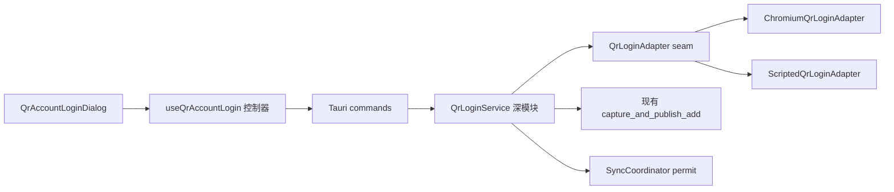

# 二维码登录可靠性与可恢复性完整实施方案

> 状态：自动化实施与验证已完成；真实 Chrome/Edge + 手机扫码发布验收待执行  
> 编写日期：2026-07-30  
> 适用范围：`apps/owstats-desktop` 账号添加、二维码登录、可见浏览器回退和凭证发布链路  
> 关联设计：`docs/superpowers/specs/2026-07-29-command-center-qr-login-dialog-design.md`  
> 关联现状记录：`qr-login-implementation-plan.md`

## 1. 背景与问题定义

用户第一次扫码登录失败后，立即点击“其他登录方式”，可能收到：

```text
添加账号失败：账号操作或赛季同步正在进行，请等待完成后再试。请重试。
```

已确认的直接原因是二维码取消 interface 只把 `cancel_requested` 设为 `true` 并立即返回；前端收到“取消请求已接受”后马上启动可见浏览器登录，而二维码后台任务仍持有全局账号操作许可。当前实现把“控制信号已接受”误当成“会话已终结、资源已清理、许可已释放”。

进一步审计发现，当前链路还存在以下会使用户停留在第一步或无法重新登录的风险：

- CDP 调用缺少统一硬超时，连接存在但不返回匹配响应时可能永久等待；
- detached 后台任务 panic 时，许可会因 Drop 释放，但二维码协调器不会进入完成态，进程内可能形成僵尸会话；
- 后端已创建会话但 Tauri command 响应丢失时，前端拿不到 `sessionId`，无法精确取消；
- 前端持续轮询失败时异常被吞掉，界面停在旧状态且没有恢复协议；
- `failed` 后前端允许刷新，但后端拒绝刷新已完成会话；
- 前端存在 `expired` 状态，后端没有生成该状态；
- 弹窗卸载采用尽力取消，不等待后台退出，快速重开或回退仍会竞争许可；
- 凭证已经提交后，如果附属的目标协调或资料刷新失败，界面仍可能显示“添加失败”，造成事实与提示不一致；
- 异常退出后没有清理遗留 `.dashen-login-*` 临时 Profile 的启动恢复。

因此本方案的目标不是修补一个按钮时序，而是建立一个可证明终结、可测试、可恢复的二维码登录深模块。

## 2. 目标

### 2.1 产品目标

无论二维码登录成功、失败、取消、过期、超时、刷新、页面关闭、IPC 异常或后台任务异常，用户都不会被困在添加账号第一步，并且能在有界时间内执行以下任一动作：

- 重新生成二维码；
- 关闭弹窗后重新扫码；
- 切换到现有可见浏览器登录；
- 在应用重启后继续正常添加账号。

### 2.2 工程目标

- 让“二维码会话已终结”成为一个明确、可等待、可测试的 interface 结果；
- 让账号操作许可、后台任务、浏览器子进程、CDP 连接和临时 Profile 由同一个模块统一拥有；
- 让成功、错误、取消、超时、panic 和 abort 走同一个终结路径；
- 使用生产浏览器 adapter 和脚本化 fake adapter 形成真实测试 seam；
- 通过模块外部 interface 测试可观察结果，不依赖实现源码正则作为主要正确性证明；
- 保留现有 `add_account` 可见浏览器登录入口和账号存储格式。

### 2.3 非目标

- 不修改网易登录协议、签名算法或 BattleTag 配对规则；
- 不改变账号目录、`accounts.json` 或 `credentials.json` 格式；
- 不把真实网易页面、真实二维码或真实凭证放入 CI；
- 不因登录失败自动删除用户已有账号、本地比赛数据或可恢复凭证；
- 不引入远程遥测、远程功能开关或上传登录状态。

## 3. 术语

- **二维码登录会话**：从后端接受一次开始请求，到所有任务、许可、浏览器和临时资源完成终结的一次生命周期。
- **控制信号已接受**：取消或刷新请求已经记录，但后台工作可能尚未停止。它不是终态。
- **已终结**：后台任务已退出，浏览器清理已完成或进入可恢复清理记录，账号操作许可已释放，最终快照已经发布。
- **提交点**：账号注册表与正式账号目录已经完成原子发布。从该点开始不能再向用户报告“账号添加失败”。
- **当前会话**：唯一允许持有账号操作许可和隐藏浏览器的二维码会话。
- **历史终态快照**：已终结会话的脱敏结果，短期保留供迟到轮询读取，不占用账号操作许可。

## 4. 不变量与验收公理

下面的不变量必须同时由实现和自动化测试保证。

### 4.1 单一所有者

同一时刻最多存在：

- 一个账号操作许可；
- 一个运行中的二维码后台任务；
- 一个二维码隐藏浏览器进程；
- 一个二维码临时 Profile；
- 一个可变的当前二维码会话。

浏览器、任务和许可不能分别由 command、协调器和 React 组件独立推断生命周期。

### 4.2 终结顺序

任何终态必须严格按照以下顺序发布：

1. 停止或 abort 工作任务；
2. 等待工作任务退出；
3. 关闭 CDP 和隐藏浏览器；
4. 删除临时 Profile，或写入不含凭证的本地清理记录供启动恢复；
5. 释放账号操作许可；
6. 从“当前会话”移除运行态；
7. 写入历史终态快照；
8. 通知等待中的取消、刷新和前端轮询；
9. 发送最终结果事件。

前端可观察到 `ready`、`failed`、`expired` 或 `cancelled` 时，后端账号操作状态必须已经是 `idle`。

### 4.3 有界终结

所有外部等待必须有硬上限，并且能够响应取消：

| 等待 | 建议生产上限 | 取消要求 |
|---|---:|---|
| 浏览器调试端点启动 | 20 秒 | 立即中断轮询 |
| 单次 HTTP/CDP 请求 | 10 秒 | 使用取消信号或 abort task |
| 单次 Token 请求 | 20 秒 | 使用取消信号或 abort task |
| 二维码会话总时长 | 180 秒 | 到期进入 `expired` 或 `failed` |
| 正常取消等待 | 3 秒 | 超过后升级为强制 abort |
| 强制终结与资源回收 | 2 秒 | 完成后必须释放许可 |

具体常量集中在 `QrLoginTimeouts`，测试使用短时配置和暂停时间，不在业务逻辑中散落数字。

### 4.4 幂等控制

- 相同 `requestId` 的重复开始请求返回同一个会话，不创建第二个浏览器；
- 同一会话重复取消返回同一个终态；
- 旧 `sessionId` 不能取消或刷新新会话；
- 并发刷新最多创建一个后继会话；
- 前端双击、React 重渲染和 IPC 重试不能产生重复账号操作。

### 4.5 提交后不报失败

- 提交点之前失败：不得新增或覆盖正式账号，返回可恢复失败；
- 提交点之后附属目标协调或资料刷新失败：返回成功并附带非阻断 warning；
- 用户看到“添加失败”时，正式账号目录和账号注册表必须保持提交前事实；
- 用户看到“添加成功”时，账号注册表和正式凭证必须已经原子提交。

### 4.6 下一操作立即可用

每个终态测试最后必须复用同一个断言：

```text
operation_status == idle
and qr_service.start(new_request_id) succeeds
and visible add_account can acquire the account permit
and no browser/profile/pending-login resource remains
```

## 5. 目标架构

### 5.1 深模块与 seam

把现有 `QrLoginCoordinator`、detached task、浏览器控制和前端推断式取消收拢为后端深模块 `QrLoginService`。



`QrLoginService` 的外部 interface 只暴露：

- 开始或恢复同一个请求；
- 获取脱敏快照；
- 刷新为一个后继会话；
- 取消并等待已终结；
- 查询当前活动会话，用于 IPC 响应丢失恢复。

CDP 选择器、图片读取、浏览器进程、超时、任务监督、资源清理、凭证验证和账号发布都隐藏在模块内部。

### 5.2 内部 adapter

定义内部 `QrLoginAdapter` seam，至少有两个 adapter：

- `ChromiumQrLoginAdapter`：生产实现，驱动 Chrome/Edge、CDP、DOM 和二维码图片；
- `ScriptedQrLoginAdapter`：测试实现，可按脚本进入任意阶段、返回错误、挂起、panic 或等待取消。

测试 adapter 记录可观察资源计数：浏览器是否启动、是否关闭、Profile 是否创建/清理、调用进行到哪个阶段。它不接触真实浏览器和网络。

账号发布不做成二维码专用 adapter；继续复用现有 `capture_and_publish_add`，避免复制事务逻辑。

## 6. 后端实施设计

### 6.1 会话标识与幂等开始

前端每次打开弹窗生成 UUID `requestId`，开始 command 改为：

```rust
#[tauri::command]
pub async fn add_account_with_qr(
    request_id: String,
    service: State<'_, QrLoginService>,
) -> Result<QrLoginStartResult, String>;
```

`QrLoginStartResult`：

```rust
pub struct QrLoginStartResult {
    pub request_id: String,
    pub session_id: String,
    pub reused: bool,
}
```

规则：

- 相同 `requestId` 重试时返回同一个仍运行或最近终结的会话；
- 不同 `requestId` 在已有运行会话时返回结构化 `qr_session_busy`，并附当前会话的脱敏恢复信息；
- command 响应丢失后，前端可使用 `requestId` 再次调用开始并取得原 `sessionId`；
- `requestId` 不写入账号文件或日志，只存在内存会话表中。

### 6.2 会话状态

建议内部结构：

```rust
struct QrLoginServiceState {
    active: Option<ActiveQrSession>,
    recent: VecDeque<TerminalQrSession>,
}

struct ActiveQrSession {
    request_id: Uuid,
    session_id: Uuid,
    generation: u64,
    phase: QrLoginPhase,
    revision: u64,
    image_base64: Option<String>,
    cancel_tx: tokio::sync::watch::Sender<ControlSignal>,
    settled: Arc<tokio::sync::Notify>,
}

struct TerminalQrSession {
    request_id: Uuid,
    session_id: Uuid,
    snapshot: QrLoginSnapshot,
    settled_at: Instant,
}
```

历史终态只保留最近 4 个或最多 10 分钟，确保迟到轮询可读取，又不无限积累二维码 Base64。进入终态前必须清空图片，只保留阶段、结果和脱敏错误。

### 6.3 任务监督器

账号操作许可由 supervisor 持有，不由实际浏览器 worker 持有：

```text
supervisor owns OperationPermit
  -> spawns worker
  -> waits for worker / cancel / session timeout
  -> aborts and joins worker when needed
  -> shuts down resources
  -> drops permit
  -> publishes terminal snapshot
```

必须处理：

- `worker` 正常返回；
- `worker` 返回业务错误；
- `worker` panic，`JoinError::is_panic()`；
- `worker` 被 abort；
- 会话总超时；
- 正常取消超时后强制 abort；
- Tauri event 发送失败。

所有分支都调用唯一的 `finalize_session()`。禁止在不同错误分支手写 `drop(permit)`、`complete()` 和浏览器清理。

### 6.4 可取消等待与硬超时

`CdpPage::call`、`connect_async`、本地 HTTP JSON 请求、DOM evaluate、图片 fetch、Token 请求和等待循环必须使用统一 helper：

```rust
async fn run_step<T>(
    phase: QrLoginPhase,
    timeout: Duration,
    cancel: &mut watch::Receiver<ControlSignal>,
    future: impl Future<Output = Result<T>>,
) -> Result<T>;
```

该 helper 使用 `tokio::select!` 同时等待：

- 工作 future；
- 取消/刷新信号；
- 阶段超时。

不得只在外层循环开头检查一次取消标志。所有 `sleep` 改为可取消 sleep。

### 6.5 取消并等待

取消 command 改为 async，并返回已终结事实：

```rust
pub struct QrLoginSettleResult {
    pub session_id: String,
    pub terminal_phase: QrLoginPhase,
    pub released: bool,
}

#[tauri::command]
pub async fn cancel_dashen_login_qr(
    session_id: String,
    service: State<'_, QrLoginService>,
) -> Result<QrLoginSettleResult, String>;
```

语义：

- 返回 `Ok` 时，`released` 必须恒为 `true`；
- command 内部等待正常取消，超时后主动 abort worker；
- 重复取消已终结会话直接返回相同结果；
- 旧 session 不能影响新 session；
- 如果 session 不存在，返回结构化 `qr_session_not_found`，前端随后查询活动会话和全局 operation 状态完成恢复，不能直接启动另一个登录。

### 6.6 刷新

刷新不是修改一个已经失败的 worker，而是“终结旧会话并创建后继会话”：

1. 取消并等待旧会话终结；
2. 确认账号操作许可已释放；
3. 使用同一个 `requestId` 的新 generation 创建新 `sessionId`；
4. 重新申请账号操作许可；
5. 创建全新浏览器和 Profile；
6. 返回新的 `sessionId`。

```rust
pub struct QrLoginRefreshResult {
    pub previous_session_id: String,
    pub session_id: String,
    pub generation: u64,
}
```

并发刷新通过 `requestId + generation` 幂等化，最多创建一个后继会话。旧二维码、旧事件和旧快照不能覆盖新会话。

### 6.7 过期

生产 adapter 需要显式报告二维码过期：

- 页面稳定暴露过期状态时立即进入 `expired`；
- 二维码图片被页面替换时只在同一 generation 内提高 `revision`；
- 无法可靠识别页面过期时，以二维码最大有效等待时间进入 `expired`；
- `expired` 是已终结状态，必须先清理资源和释放许可，用户再选择刷新；
- 不自动无限创建浏览器或二维码。

### 6.8 浏览器和 Profile 清理

把 `BrowserLoginSession` 从仅依赖同步 `Drop` 改为显式、可验证的 shutdown：

```rust
pub async fn shutdown(&mut self, timeout: Duration) -> BrowserShutdownReport;
```

流程：

1. 关闭 CDP socket；
2. 请求浏览器退出；
3. 有界等待子进程；
4. 超时后强制 kill；
5. 再次有界等待；
6. 删除 Profile；
7. 删除失败时创建不含凭证和绝对路径的清理标记。

`Drop` 只作为最后兜底，不能承担正常正确性。

应用启动时扫描数据根目录直属的 `.dashen-login-<uuid>`：

- 只接受严格名称格式；
- 拒绝符号链接、junction 和 reparse point；
- 只删除应用数据根目录内的匹配目录；
- 清理失败不阻止用户使用可见浏览器登录，但记录脱敏分类；
- 增加 Windows junction/符号链接安全测试。

### 6.9 凭证验证与提交语义

保留现有结构校验，并在正式发布前增加一个轻量 authenticated probe：

- 验证 Token 能访问约定的只读接口；
- 验证响应身份与捕获的 `role_id` 一致；
- 401/403 或业务鉴权失败时不发布；
- 网络暂时不可用时返回可恢复失败，不写正式凭证；
- probe 不记录 Token、请求头、响应体或玩家身份。

账号发布结果改为内部结构化语义：

```rust
enum LoginCommitOutcome {
    NotCommitted { error_code: &'static str },
    Committed { result: AccountLoginResult, warnings: Vec<&'static str> },
}
```

`capture_and_publish_add` 成功即视为提交点。之后的登录目标协调、资料卡刷新等附属工作：

- 失败只增加 warning；
- 最终二维码阶段仍为 `ready`；
- 前端提示“账号已添加，部分资料将在稍后刷新”；
- 不允许把已提交事实映射为 `qr_publish_failed`。

### 6.10 已有失效凭证

同步或只读 authenticated 请求明确返回 401/403 时：

- 原子把账号 `credentialState` 改为 `stale`；
- 保留账号目录和本地比赛数据；
- 不自动删除 `credentials.json`；
- 禁止自动赛季同步继续使用该凭证；
- 指挥台提供“重新登录/更新账号”入口；
- 新登录成功后原子替换凭证并恢复 `ready`。

这部分与二维码会话解锁分开实现，但应在同一发布周期验收，避免“登录成功后马上因失效凭证再次卡住”。

## 7. 前端实施设计

### 7.1 独立控制器

新增 `src/features/command-center/useQrAccountLogin.ts`，让 `QrAccountLoginDialog` 只负责显示和可访问交互。

控制器拥有：

- `openCycleId`；
- `requestId`；
- 当前 `sessionId` 和 generation；
- phase、message、revision、PNG URL；
- start/poll/cancel/refresh/fallback 的单飞状态；
- 连续轮询失败次数；
- 卸载清理 Promise。

`OnboardingPage` 不再直接编排 `cancel -> close -> addAccount`。

### 7.2 启动与 IPC 恢复

1. 打开弹窗时生成 `requestId`；
2. 注册结果/进度事件监听；
3. 调用 `add_account_with_qr(requestId)`；
4. command 超时或响应丢失时，用同一 `requestId` 重试开始；
5. 仍失败时调用 `get_active_dashen_login_qr(requestId)`；
6. 找到会话则接管轮询；
7. 找不到会话且全局 operation 为 idle 时允许重新开始；
8. operation 为 account 时显示“正在恢复登录会话”，并提供“结束并重试”，不能直接调用可见登录。

现有 10 秒 watchdog 不能只修改 UI；它必须执行上述后端恢复协议。

### 7.3 快照为单一事实源

- 后端快照是状态事实源；
- Tauri event 只用于唤醒立即拉取快照，不直接完成关键状态迁移；
- 每次快照校验 `requestId/sessionId/generation/revision`；
- 连续 3 次轮询失败进入 `recovering` UI 状态并执行活动会话查询；
- 轮询恢复后继续当前会话；
- 持续失败时仍允许“结束并重试”，该动作按 `requestId` 取消活动会话并等待终结。

### 7.4 其他登录方式

唯一合法顺序：

```ts
const settled = await cancelQrAndWait(currentSessionId);
assert(settled.released);
clearQrMemory();
closeDialog();
await runExistingAddAccountOperation();
```

如果取消 command 暂时失败：

- 查询当前会话和 operation 状态；
- 只有确认二维码已终结且 operation 为 idle 才能启动可见登录；
- 否则停留在弹窗并显示“正在结束二维码登录，请稍候”；
- 提供再次结束按钮，不把后台 busy 包装为“添加账号失败”。

### 7.5 关闭、卸载和重新打开

- 取消按钮、关闭按钮、Esc 和遮罩走同一个 `cancelAndClose()`；
- 关闭 UI 前等待后端终结；
- 页面卸载时发出取消；无法等待 UI Promise 时，后端仍依靠会话总超时和 supervisor 自愈；
- 重新打开先查询活动会话：可接管则接管，需终结则等待终结，不能盲目创建第二个会话；
- `saving` 或已跨提交点时禁用关闭和回退，等待明确成功；
- `capturing` 在提交点前允许取消；进入提交点后切换到不可取消的 `saving`。

### 7.6 刷新与失败恢复

- `waitingForScan`、`expired`、可恢复 `failed` 可刷新；
- 刷新返回新 `sessionId` 后再清除旧图片；
- 旧 refresh 响应和旧事件按 generation 丢弃；
- 刷新失败时旧会话已终结，用户仍能重试刷新或选择其他登录方式；
- 不对已完成会话调用现有“仅修改 generation”的 refresh。

### 7.7 图片与内存

- 优先使用 Blob URL；
- 每次替换图片、终态、关闭和卸载都 `URL.revokeObjectURL()`；
- 不写 `localStorage`、`sessionStorage`、IndexedDB、日志或错误对象；
- 历史终态快照不含 Base64，降低内存残留和迟到读取风险。

## 8. 错误分类与用户文案

错误返回结构化 code，UI 自己映射固定中文恢复文案。至少包含：

| code | 用户文案方向 | 可恢复动作 |
|---|---|---|
| `qr_browser_not_found` | 未找到 Chrome 或 Edge | 其他登录方式不可用时提示安装浏览器 |
| `qr_browser_start_failed` | 无法启动安全登录环境 | 刷新、关闭重试 |
| `qr_step_timeout` | 登录页面响应超时 | 刷新、其他登录方式 |
| `qr_page_changed` | 网易登录页面已变化 | 其他登录方式 |
| `qr_expired` | 二维码已过期 | 刷新 |
| `qr_cancelled` | 已取消二维码登录 | 关闭，不显示错误 |
| `qr_worker_failed` | 登录任务异常结束 | 重新打开、其他登录方式 |
| `qr_transport_recovering` | 正在恢复登录会话 | 结束并重试 |
| `qr_credentials_rejected` | 登录信息无效 | 刷新、其他登录方式 |
| `qr_committed_with_warning` | 账号已添加，部分资料稍后刷新 | 进入指挥台 |

日志只允许：code、phase、浏览器种类、耗时区间、是否强制 abort、清理是否成功。禁止二维码、Token、Cookie、Authorization、roleId、BattleTag、CDP URL、端口、Profile 绝对路径、页面 HTML 和响应体。

## 9. 自动化测试方案

### 9.1 第一条红灯回归测试

首先新增能精确复现当前用户问题的测试：

```text
start QR -> adapter enters waitingForScan
-> request other login
-> cancellation is delayed
-> visible login must not start before QR settles
-> after settle visible login acquires permit successfully
```

修复前必须因 `SYNC_IN_PROGRESS_MESSAGE` 失败；修复后变绿。禁止用源码正则代替这条行为测试。

### 9.2 后端模块 interface 测试

新增 `src-tauri/tests/qr_login.rs` 或在模块内部建立等价的公开测试 seam，使用 `ScriptedQrLoginAdapter`。

#### 生命周期矩阵

对以下每个阶段运行取消：

- starting；
- openingLogin；
- selectingQrMode；
- acceptingPrivacy；
- loadingQr；
- waitingForScan；
- confirming；
- capturing；
- saving 前；
- 提交点后。

每次断言：单一终态、许可 idle、可立即新开二维码、可立即开始可见登录、资源计数为零。

#### 故障矩阵

- 浏览器不存在；
- 浏览器进程启动失败；
- 调试端点超时；
- CDP connect 超时；
- CDP socket 存活但永不返回匹配响应；
- 登录按钮缺失；
- 扫码入口缺失；
- 隐私确认出现/不出现/结构改变；
- 二维码图片缺失、伪造 MIME、超限、异常尺寸、非正方形；
- DOM fetch 失败后截图成功；
- DOM fetch 与截图同时失败；
- Token 请求 401、403、5xx、业务失败、非 JSON、超时；
- BattleTag 不稳定或与 roleId 冲突；
- adapter 主动 panic；
- worker 被 abort；
- Tauri event 发送失败；
- Profile 第一次删除失败、重试成功；
- Profile 持续删除失败并由启动恢复清理。

#### 并发与幂等

- 相同 `requestId` 并发开始 100 次只创建一个浏览器；
- 不同 `requestId` 并发开始只有一个成功；
- 重复取消返回相同终态；
- 取消与刷新竞争只有一个后继结果；
- 连续刷新 generation 单调且一次只有一个浏览器；
- 旧 session 的取消、刷新、图片和终态不能影响新 session；
- completion 可见时 operation 必须已经 idle。

#### 时间测试

使用 Tokio 暂停时间或短时配置，不真实等待 180 秒：

- 每个阶段 timeout 可确定触发；
- 正常取消超过 grace 后强制 abort；
- 强制 abort 后仍在总预算内释放许可；
- 过期进入 `expired` 并释放资源；
- 历史终态按 TTL/数量清理且不含图片。

### 9.3 账号发布测试

扩展现有 `account_login`/`phase9_multi_account` 测试：

- authenticated probe 失败不创建账号和暂存残留；
- 新账号提交前每个 fault point 完整回滚；
- 已有账号更新前每个 fault point 恢复旧凭证；
- 注册表提交后目标协调失败返回 success + warning；
- 注册表提交后资料刷新失败返回 success + warning；
- UI 失败结果与磁盘未提交事实一致；
- 401/403 把已有凭证标记为 stale，但不删除本地账号数据；
- 重新登录成功把 stale 恢复为 ready。

### 9.4 浏览器资源测试

- 测试 adapter 验证每条路径都调用 shutdown；
- Windows 测试使用受控子进程验证正常退出、强制 kill 和有界等待；
- 临时目录删除失败、文件占用、符号链接和 junction 均不越界删除；
- 启动恢复只清理严格匹配、位于数据根目录直属层级的 `.dashen-login-<uuid>`；
- 外部目录 sentinel 始终不变。

### 9.5 前端控制器测试

建议引入 Vitest、Testing Library、user-event 和 jsdom；纯状态协调优先测试控制器，DOM 行为测试弹窗。

控制器测试：

- 事件监听先于 start；
- start 响应丢失后使用同一 `requestId` 恢复；
- 轮询偶发失败后恢复；
- 连续轮询失败进入 recovering，并能结束会话；
- 只接受当前 session/generation 和更高 revision；
- 其他登录方式严格等待 settle；
- settle 未完成时绝不调用 `addAccount`；
- settle 完成后只调用一次 `addAccount`；
- 快速双击取消、刷新、其他登录方式都保持单飞；
- 卸载与立即重开不会创建第二会话；
- failed/expired 后刷新取得新 session；
- 成功与 committed warning 都刷新账号列表；
- 预期取消不显示“添加账号失败”。

弹窗测试：

- 状态对应按钮启用规则；
- saving/ready 阶段不能关闭或回退；
- Esc、遮罩、关闭按钮与取消按钮走同一路径；
- 焦点约束和关闭后恢复；
- `aria-live` 与 `role=alert`；
- Blob URL 替换和卸载撤销；
- 窄屏无横向滚动、二维码舞台无布局跳动。

### 9.6 Tauri command 集成测试

- command 参数和 DTO 序列化；
- start/active/snapshot/cancel/refresh 完整往返；
- final snapshot 可见时 `get_operation_status == idle`；
- 可见登录回退不会得到二维码遗留 busy；
- 错误 DTO 和事件不含敏感字段；
- command 响应重试的 `requestId` 幂等行为。

### 9.7 真实浏览器手工 smoke

CI 不连接真实网易页面。发布前在匿名测试数据目录执行：

- Chrome、Edge 各一次生成二维码；
- 未扫码等待、二维码过期、刷新；
- 扫码未确认后取消；
- 扫码确认并新增账号；
- 已有账号更新；
- 网络断开、恢复；
- 隐藏浏览器被任务管理器结束；
- 点击其他登录方式；
- 快速关闭、重开；
- 应用在等待扫码时退出并重启；
- 检查进程、端口、Profile、日志和前端存储无残留。

测试记录只保存阶段和脱敏分类，不保存真实二维码、Token、账号标识或页面截图。

## 10. 文件级改动

| 文件 | 计划改动 |
|---|---|
| `src-tauri/src/qr_login.rs` | 重构为 `QrLoginService`、supervisor、统一终结、幂等会话和历史终态 |
| `src-tauri/src/browser_session.rs` | 为 CDP 调用增加硬超时/取消；增加显式 async shutdown 和启动残留清理 |
| `src-tauri/src/credentials.rs` | 提供可取消凭证捕获和 authenticated probe seam |
| `src-tauri/src/account_login.rs` | 明确提交点与 committed warning 语义 |
| `src-tauri/src/account_context.rs` | 启动时安全恢复临时 Profile；支持 stale 凭证状态更新 |
| `src-tauri/src/commands.rs` | start 使用 requestId；cancel async settle；refresh 创建后继会话；增加 active query |
| `src-tauri/src/lib.rs` | 注册新的 managed state 和 commands |
| `src-tauri/src/models.rs` | 增加结构化 settle/refresh/result DTO |
| `src-tauri/tests/qr_login.rs` | 新增后端 interface、fault、timeout、panic、并发和资源测试 |
| `src-tauri/tests/phase9_multi_account.rs` | 增加验证、提交点、warning、stale 与恢复测试 |
| `src/features/command-center/useQrAccountLogin.ts` | 新增前端登录控制器 |
| `src/features/command-center/QrAccountLoginDialog.tsx` | 收敛为展示模块，接入新控制器状态和操作 |
| `src/features/command-center/accountOperationIsolation.ts` | 增加等待二维码终结后回退的编排函数 |
| `src/pages/OnboardingPage.tsx` | 移除直接二维码时序编排，接入控制器 |
| `src/shared/api.ts` | 更新 start/cancel/refresh/active commands |
| `src/shared/types.ts` | 增加 requestId、settle、refresh 和结构化错误类型 |
| `scripts/accountOperationIsolation.test.ts` | 增加其他登录方式严格时序测试 |
| `scripts/qrAccountLoginController.test.ts` | 新增前端控制器完整状态机测试 |
| `scripts/qrAccountLoginDialog.test.tsx` | 新增交互、可访问性和图片清理测试 |
| `package.json` | 注册新增测试；若采用 Vitest，则增加最小测试依赖和命令 |

实现前逐文件检查工作树，保留用户已有修改；不得回退与本方案无关的 `Cargo.toml` 和本地工具文件改动。

## 11. 分阶段实施顺序

### 阶段 0：建立红灯与基线

1. 新增“失败后立即选择其他登录方式”的行为回归测试；
2. 新增终态通用 `assert_login_reusable`；
3. 记录当前测试红灯输出；
4. 跑现有账号、同步和前端测试，记录基线；
5. 不修改生产行为。

完成条件：精确用户症状能够稳定、快速、无人值守复现。

### 阶段 1：后端会话深模块

1. 引入 `QrLoginService` 和 `QrLoginAdapter` seam；
2. 实现 requestId 幂等开始；
3. supervisor 独占 permit；
4. 实现统一 `finalize_session`；
5. 先用 fake adapter 让 success/error/cancel/panic/timeout 测试通过；
6. 保持生产 adapter 行为暂时不变。

完成条件：所有 fake adapter 终态均满足许可释放和立即复用。

### 阶段 2：有界 I/O 与资源清理

1. 给 CDP、HTTP、sleep、Token 捕获增加取消与超时；
2. 实现浏览器显式 shutdown；
3. 实现 Profile 启动恢复；
4. 接入生产 Chromium adapter；
5. 跑故障矩阵。

完成条件：挂起、panic、abort 和资源错误都在预算内终结。

### 阶段 3：取消、刷新和过期协议

1. cancel command 改为 cancel-and-wait；
2. refresh 改为终结旧会话并创建后继会话；
3. 增加 active session 恢复查询；
4. 实现 expired 后端状态；
5. 加入并发、幂等和迟到事件测试。

完成条件：任何终态后重新扫码和可见登录都立即可用。

### 阶段 4：前端控制器

1. 新增 `useQrAccountLogin`；
2. 接入 requestId、轮询恢复和单飞控制；
3. 修复其他登录方式时序；
4. 修复关闭、卸载、重开和刷新；
5. 增加控制器与弹窗测试。

完成条件：前端不再自行猜测后台已经取消，所有恢复动作可测试。

### 阶段 5：凭证提交语义

1. 增加 authenticated probe；
2. 标记明确提交点；
3. 提交后附属失败改为 warning；
4. 实现已有凭证 401/403 -> stale；
5. 跑账号发布 crash/fault 测试。

完成条件：UI 成败与磁盘事实一致，错误凭证不进入正式账号目录。

### 阶段 6：全量验证与发布

1. 运行 Rust、前端、构建和文本完整性测试；
2. 执行 Chrome/Edge smoke；
3. 执行应用退出/重启恢复；
4. 检查敏感信息和临时资源；
5. 在 beta 版本观察用户反馈后再作为默认稳定入口。

完成条件：满足第 12 节发布门槛。

## 12. 发布门槛

以下任一项失败都不得发布：

1. 用户原始复现测试仍能出现 busy 错误；
2. 任一终态后 operation status 不是 idle；
3. 任一取消/超时/panic 路径遗留浏览器或 Profile；
4. 同 requestId 能创建两个浏览器；
5. start 响应丢失后不能恢复或终结会话；
6. 轮询持续失败后没有“结束并重试”；
7. failed/expired 的刷新不能创建新会话；
8. 已提交账号仍向用户报告添加失败；
9. 401/403 凭证仍被标记 ready 并自动同步；
10. 日志、事件、DTO、测试快照或诊断输出包含敏感数据；
11. Chrome 或 Edge 至少一条受支持回退路径不可用；
12. 全量测试或构建失败。

建议验证命令：

```powershell
cd apps\owstats-desktop
npm test
npm run build

cd src-tauri
cargo test --lib
cargo test --test qr_login
cargo test --test phase9_multi_account
cargo test

cd ..\..\..
git diff --check
```

## 13. 回滚策略

- 保留现有 `add_account` 和 `addAccount()`，它们始终是独立回退入口；
- 新模块不改变账号存储和数据库 schema，回滚无需数据迁移；
- 如果真实页面兼容率不足，可以把默认“添加账号”临时切回可见浏览器，但不能删除二维码可靠性代码或测试；
- 如 command DTO 在 beta 中需要回滚，前后端必须同版本发布，不维护跨版本 WebView 协议；
- 回滚前仍要保证活动二维码 supervisor 能终结，不能通过隐藏按钮绕过资源释放。

## 14. 完成定义

只有同时满足以下条件，本方案才算完成：

- 原始用户问题的回归测试由红变绿；
- 第 9 节自动化矩阵完成，不能用源码断言代替关键行为测试；
- 后端任何退出路径都通过统一终结器；
- 前端任何恢复操作都等待后端已终结事实；
- Chrome/Edge 真实 smoke 和应用重启恢复通过；
- UI 成败与账号磁盘提交事实一致；
- 敏感信息审计通过；
- 不再存在“关闭或重启应用是解除登录占用的唯一办法”的路径；
- 用户可以在任何失败界面通过至多一次明确操作回到可扫码或可见浏览器登录状态。

## 15. 2026-07-30 实施记录

已完成后端会话监督、`requestId` 幂等恢复、取消并等待、后继会话刷新、过期与历史快照、CDP/浏览器/Profile 显式回收、提交前凭证探测、提交后 warning、401/403 凭证失效传播，以及前端恢复控制器和弹窗交互收敛。

自动化验证结果：

- QR scripted adapter 生命周期、并发、panic、abort、过期与资源回收矩阵：30 项通过；
- 本机 Chrome 与 Edge 真实 headless smoke：DevTools 启动、网易登录页扫码模式、有效 PNG 提取、CDP/进程退出与临时 Profile 清理均通过；
- 前端二维码已改为短生命周期 Blob URL，并验证替换、终态和卸载时执行 revoke；
- Rust `cargo test --all-targets`：通过；仅保留一个按设计忽略、需要已登录真实浏览器的测试；
- 前端 `npm test`：通过；
- 前端 `npm run build`：通过；
- `cargo fmt --all -- --check` 与 `git diff --check`：作为提交前门槛执行。

发布前仍必须人工完成第 9.7 节中需要手机或桌面交互的部分：手机确认扫码、未确认取消、切换其他登录方式、快速关闭重开，以及等待扫码时退出应用后重启。未完成该项前，不把第 14 节的完整发布验收标记为完成。
